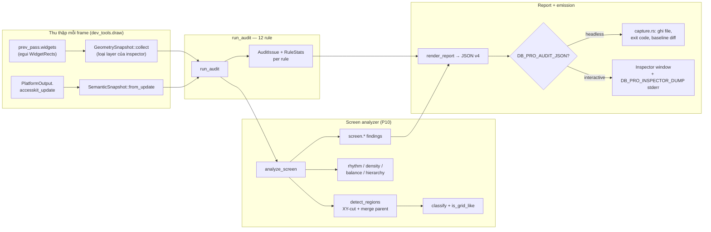

# Bộ máy audit UI (debug-build) — `crates/ui/src/dev_tools/`

Tài liệu mức hàm cho engine audit chỉ tồn tại trong debug build. Engine thu thập hình học widget (`egui::WidgetRects`) và ngữ nghĩa AccessKit mỗi frame, chạy 12 rule widget-level, chạy thêm bộ phân tích mức màn hình (P10: phân đoạn vùng bằng XY-cut trên whitespace + merge theo parent, phân loại vùng, metrics rhythm/density/balance/hierarchy, và findings mức màn hình), rồi xuất report JSON theo schema có version (`SCHEMA_VERSION = 4`) cho chế độ headless `DB_PRO_AUDIT_JSON` và script `tools/ui-audit-matrix.sh`.

Toàn bộ module bị biên dịch bỏ trong release build (`debug_assertions`).

## Pipeline tổng thể

## `mod.rs` — inspector state, driver emission, fixture

Inspector UI cho debug build. Không chứa rule; nó điều phối pipeline và vẽ panel.

| Hằng số env | Giá trị | Vai trò |
|---|---|---|
| `OPEN_ON_START_ENV` | `DB_PRO_INSPECTOR` | Mở inspector ngay frame đầu (dùng trong capture runs). |
| `PICK_ENV` | `DB_PRO_INSPECTOR_PICK` | `"x,y"` (points) → pin một widget selection theo chương trình, không cần input injection. |
| `AUDIT_FIXTURE_ENV` | `DB_PRO_INSPECTOR_AUDIT_FIXTURE` | Vẽ fixture cố tình lỗi (overlap + zero-size) để audit có evidence xác định. |
| `AUDIT_DUMP_ENV` | `DB_PRO_INSPECTOR_DUMP` | In toàn bộ issue ra stderr một lần khi pipeline "warm". (Không phải `DB_PRO_AUDIT_DUMP`.) |

- `inspector_id() -> egui::Id`: Id cố định `"dbpro_dev_tools_inspector"`; layer của nó bị lọc khỏi mọi listing/pick để tool không tự đo chính mình.
- `parse_pick_env() -> Option<Pos2>`: parse `"x,y"`; trả `None` khi thiếu/malformed.
- `DevToolsState`: trạng thái inspector. Trường đáng chú ý:
  - `selected: Option<SelectedWidget>` — selection được pin, re-resolve mỗi frame.
  - `audit` / `prev_audit` — report hiện tại và frame trước (baseline cho diff new/resolved).
  - `audit_frames` — số frame đã audit; dùng cho warm gate và `meta.frames`.
  - `pending_audit: Option<(serde_json::Value, i32)>` — emission headless chờ `take_audit_emission`.
  - `stable_streak` — số frame liên tiếp có `layout_fingerprint` trùng nhau.
  - `fixture_painted` — provenance cho privacy gate của visual review: chỉ set khi fixture thực sự được vẽ, không phải chỉ do env.
- `Default for DevToolsState`: `open` lấy từ `DB_PRO_INSPECTOR` (bỏ qua chuỗi rỗng/`"0"`); `pending_pick` từ `parse_pick_env`.
- `DevToolsState::take_audit_emission(&mut self) -> Option<(Value, i32)>`: lấy (JSON, exit code) nếu `draw` vừa emit; `None` khi `DB_PRO_AUDIT_JSON` không set hoặc pipeline chưa warm.
- `DevToolsState::fixture_provenance(&self) -> bool`: true khi một fixture surface đã được paint trong session.
- `DevToolsState::draw(&mut self, ctx, theme)`: vòng đời pipeline mỗi frame — thoát sớm nếu đóng và không headless; vẽ fixtures; `AccessKitCapture::ensure_installed` + lấy `SemanticSnapshot`; `GeometrySnapshot::collect`; update selection + highlight; `run_audit`; `maybe_dump_audit`; `maybe_emit_headless`; rồi vẽ cửa sổ inspector nếu mở. Headless (`DB_PRO_AUDIT_JSON` non-empty) chạy toàn bộ pipeline với cửa sổ đóng.
- `audit_pipeline_warm(&mut self, report) -> bool`: điều kiện emit = `widget_count >= ready_min` (`DB_PRO_AUDIT_READY`, mặc định 1) **và** (`stable_streak >= 2` hoặc `audit_frames > 30`) **và** (rule `semantic.missing_name` đã evaluate ít nhất 1 node **hoặc** `audit_frames > 120` — fallback khi accesskit tắt). Fingerprint ổn định thay cho warm-up cố định vì pass đầu của một `Area` đăng ký children `enabled=false`.
- `maybe_dump_audit(...)`: một lần duy nhất, chỉ khi warm và `DB_PRO_INSPECTOR_DUMP` bật → gọi `dump_audit_issues`.
- `maybe_emit_headless(&mut self, report, ctx, warm, theme)`: khi warm + `DB_PRO_AUDIT_JSON` set → dựng `ReportContext` (viewport từ `DB_PRO_WINDOW_SIZE`, scenario từ `DB_PRO_AUDIT_SCENARIO` mặc định `"shell"`, theme label `"Dark"`/`"Light"` từ `DbProTheme`), render report, nếu `DB_PRO_AUDIT_BASELINE` set thì gắn `baseline` diff vào JSON, lưu `(json, exit_code(report))` vào `pending_audit`. Emit tối đa một lần.
- `draw_inspector_window`, `draw_selected_section`, `draw_geometry_detail`, `draw_widget_hits`, `draw_hit_row`, `draw_audit_section`, `draw_screen_section`, `draw_issue_row`, `draw_debug_paint_toggles`, `row`, `section`: render UI inspector — selection detail, bảng verdict per-rule (click issue → pin widget), hit-test list, toggle `egui::DebugOptions`, `ctx.inspection_ui`. Screen findings render muted vì không ảnh hưởng verdict.
- `audit_fixture_enabled() -> bool`: `DB_PRO_INSPECTOR_AUDIT_FIXTURE` non-empty, khác `"0"`.
- `paint_audit_fixture(ctx)`: vẽ trong một `Area` (cùng layer → overlap cùng-area) hai nút hitbox overlap >50% không containment + một widget zero-size interactive — evidence xác định cho `overlap.suspicious` / `interactive.zero_size`.
- `screen_fixture_mode() -> Option<String>`: đọc `DB_PRO_AUDIT_SCREEN_FIXTURE`; `"ugly"` = layout cố tình lỗi, giá trị non-empty khác = layout sạch.
- `paint_screen_fixture(ctx, mode)`: vẽ IDE layout thu nhỏ trong `SCREEN_FIXTURE_RECT` (top bar, rail, content, status bar) trên layer riêng `dbpro_screen_audit_fixture`; `ugly` phá composition (rail chiếm đa số, outlier gap, widget off-screen). Dùng `new_child` per-zone để mỗi zone có `parent_id` riêng — đó là cách analyzer nhìn thấy cấu trúc pane.
- `fixture_place`, `paint_fixture_zone`, `fixture_offscreen_widget`: helpers vẽ fixture — `allocate_rect` + `widget_info` để đăng ký widget có tên dưới zone Ui; `fixture_offscreen_widget` đặt widget interactive hoàn toàn ngoài fixture screen làm evidence cho finding off-screen.
- `dump_audit_issues(report, snapshot)`: in stderr — header số issue/widget, một dòng `RULE` per rule (verdict + eval/skip/na), toàn bộ `WID` widget (layer/parent/rect/flags), các `SCREEN` finding, và `ISSUE` lines với join ngược về geometry (`" (no geometry join)"` khi widget đã biến mất). stderr là interface của env này, không phải debug leak.

## `geometry.rs` — snapshot hình học widget

Đóng băng `WidgetRect` + `WidgetInfo` của một pass thành dữ liệu owned, không phụ thuộc egui lock. Rect lưu theo tọa độ *layer-local*; `to_global_rect` áp transform của layer. `parent_id` là parent Ui thật egui ghi; `clipped` suy ra bằng `interact_rect != rect` (egui pre-clip interact rect theo clip của parent).

- `GeometryRect { min_x, min_y, max_x, max_y: f32 }`: rect owned.
  - `from_egui(Rect)`, `to_egui() -> Rect`, `width()`, `height()`.
- `WidgetGeometry`: một widget trong một pass — `id`/`id_debug`, `parent_id`/`parent_debug`, `layer`/`layer_debug`, `rect`, `interact_rect`, `clipped`, `senses_click`, `senses_drag`, `focusable`, `enabled`, và semantic info từ `Response::widget_info` (`widget_type`, `label`, `hint_text`, `current_text_value`, `selected`, `value` — Option, luôn có trong debug build khi widget báo).
  - `from_egui(widget, info)`: map toàn bộ field; `clipped = interact_rect != rect`.
  - `to_global_rect(ctx) -> Rect`: `ctx.layer_transform_to_global(layer)`; layer không có transform → identity.
- `GeometrySnapshot { layers: Vec<(LayerId, Vec<WidgetGeometry>)> }`: mọi widget của pass, nhóm theo layer, sắp front-most trước.
  - `collect(ctx, exclude_area)`: đọc `viewport.prev_pass.widgets`, bỏ layer của inspector (`is_area_layer`), sort theo `Reverse(order)`.
  - `pick(ctx, pos) -> Option<&WidgetGeometry>`: widget front-most có `interact_rect` chứa `pos` (global). Bỏ layer `Tooltip`/`Debug`; chỉ widget `enabled`.
  - `find(id) -> Option<&WidgetGeometry>`: tra lại theo id — giữ selection sống qua frame.
- `SelectedWidget { picked, live }`: selection pin; `current()` ưu tiên `live`, fallback `picked` khi widget biến mất (popup đóng, scroll ra khỏi view).
- `is_area_layer(layer, area) -> bool`: `layer.id == area && order == Middle`.
- `transform_debug(ctx, layer) -> String`: `"scale … offset …"` hoặc `"identity"`.

## `semantic.rs` — capture cây AccessKit

egui 0.36 emit `accesskit::TreeUpdate` vào `PlatformOutput` cuối mỗi pass **chỉ khi** accesskit được bật (`Context::enable_accesskit`, sticky). Node và widget chia sẻ cùng `egui::Id` (`Id::accesskit_id`) — join duy nhất giữa hai snapshot. Rule không suy đoán parent/focus: thiếu `TreeUpdate` hoặc thiếu parent entry → rule skip, không đoán.

- `AccessKitCapture` (egui `Plugin`): `output_hook` clone update mỗi frame vào `Mutex<Option<TreeUpdate>>`. Clone (không take) để luồng assistive-tech thật không bị ảnh hưởng; mutex poisoned → bỏ frame đó.
  - `ensure_installed(ctx)`: `enable_accesskit` + `add_plugin` — cả hai idempotent.
  - `latest(ctx) -> Option<TreeUpdate>`: tree mới nhất đã capture.
- `SemanticNode`: node đã flatten — `widget_id: Option<Id>` (`None` cho root window), `node_id`, `role`/`role_debug`, `name` (label → labelled_by → `value` cho role Label; whitespace-only coi như không có tên), `disabled`, `hidden`, `supports_click`, `supports_focus`, `parent: Option<NodeId>`.
- `SemanticSnapshot { nodes: HashMap<NodeId, SemanticNode>, focus: Option<NodeId> }`.
  - `from_update(update) -> Option<Self>`: `None` khi update không có node. Parent map được suy ra từ danh sách `children` — `Node` không có field parent. `focus = Some(update.focus)`.
  - `find_widget(id) -> Option<&SemanticNode>`: tra theo `id.accesskit_id()`.
- `u64_to_id(bits) -> Option<Id>`: đảo `NodeId` về `Id` (bits chính là hash của Id); `None` cho 0.
- `is_name_required_role(role) -> bool`: 23 role bắt buộc có accessible name — Button, CheckBox, RadioButton, ComboBox, Slider, SpinButton, TextInput, MultilineTextInput, Link, MenuItem, MenuItemCheckBox, MenuItemRadio, Tab, TreeItem, ListBoxOption, Switch, SearchInput, ColorWell, Splitter, ScrollBar, Cell, RowHeader, ColumnHeader.

## `audit.rs` — engine rule mức widget

Registry 12 rule; mỗi rule là một fn `(ctx, &GeometrySnapshot, Option<&SemanticSnapshot>) -> (Vec<AuditIssue>, RuleStats)`. Hợp đồng: *evidence hoặc im lặng* — mọi issue kèm con số + `Confidence`; thiếu dữ liệu → `skipped`, không đoán. *Layout không phải bug* — overlap hợp lệ (containment, cross-layer overlay, clipped) không flag. *Snapshot read-only.*

### Kiểu dữ liệu

- `Confidence::{High, Medium}`; `label()` → `"high"`/`"medium"`. High = hình học tự mâu thuẫn hoặc widget bị che hoàn toàn; Medium = tín hiệu mạnh nhưng layout hợp lệ có thể sinh ra.
- `Severity::{Warning, Error}`; `label()` → `"warning"`/`"error"`.
- `AuditIssue { rule_id, severity, confidence, widget_id, widget_debug, other_id, evidence }` — `widget_id` giữ typed để pin lại widget qua `snapshot.find`.
- `SkipReason::{Clipped, IntentionalOverlay, NoSemanticTree, NonOpaqueColors}`.
- `RuleStats { evaluated, skipped, skip_reason, not_applicable }` — `not_applicable` ≠ `skipped`: N/A = không có gì trong scope; Skip = trong scope nhưng thiếu evidence.
- `Verdict::{Pass, Fail, Skipped, NotApplicable}`.
- `RuleReport::verdict()`: issues>0 → Fail; evaluated>0 → Pass; chỉ có skip → Skipped; trống → NotApplicable (không bao giờ PASS khi evaluate 0).
- `AuditReport { issues, rules, screen: Option<ScreenAnalysis>, widget_count, widget_ids, layout_fingerprint }`.
  - `equivalent_snapshot(other)`: bằng `widget_ids` — chỉ diff hai report cùng widget set.
  - `issue_key(issue)`: `"rule|widget_debug|other_debug"` — identity ổn định qua frame.
  - `diff(prev) -> Option<(new, resolved)>`: `None` khi snapshot không tương đương.

### Hàm điều phối

- `type Rule = fn(&Context, &GeometrySnapshot, Option<&SemanticSnapshot>) -> (Vec<AuditIssue>, RuleStats)`.
- `layout_fingerprint(snapshot) -> u64`: hash order-independent của `(id, rect×2 as i64)` — bằng nhau giữa hai audit liên tiếp = layout đã settle; thay cho đếm frame warm-up cố định.
- `RULES` — 12 rule theo thứ tự report (bảng dưới).
- `run_audit(ctx, snapshot, semantic) -> AuditReport`: khởi tạo `widget_count`/`widget_ids`/`fingerprint`, chạy tuần tự `RULES` gom `RuleReport` + issues, rồi luôn gắn `screen = Some(analyze_screen(ctx, snapshot, semantic, &fixture_scope()))`. Snapshot rỗng là hợp lệ → report rỗng.
- `no_semantic_data()`: `RuleStats{skipped:1, skip_reason:NoSemanticTree}` cho mọi rule cần cây semantic.

### Các rule và ngưỡng

| Hằng số | Giá trị | Dùng bởi |
|---|---|---|
| `MIN_HIT_SIZE` | `1.0` px | `interactive.zero_size` |
| `OVERLAP_MED` | `0.5` | `overlap.suspicious` (Medium) |
| `OVERLAP_HIGH` | `0.9` | `overlap.suspicious` (High) |
| `WCAG_AA_NORMAL` | `4.5` | `visual.text_contrast` |
| `TOUCHING_GAP_PX` | `1.0` px | `visual.touching_controls` |
| `DRIFT_MIN_PX` | `0.5` px | `visual.alignment_drift` |
| `DRIFT_MAX_PX` | `4.0` px | `visual.alignment_drift` |

1. `geometry.invalid` — `rule_invalid_geometry`: flag khi bất kỳ thành phần rect nào NaN/±∞ hoặc `min > max` (width/height âm). Error/High. Luôn evaluate được — không bao giờ skip.
2. `interactive.zero_size` — `rule_zero_size_interactive`: widget `enabled` + (click/drag/focusable) mà `interact_rect` < 1.0px một chiều → Error/High. Widget `clipped` → skip (`Clipped`); widget không interactive/disabled → ngoài scope.
3. `overlap.suspicious` — `rule_suspicious_overlap`: cặp widget enabled + click/drag **cùng `layer.id` và `layer.order`** có interact rect overlap (global space) không containment. Coverage = diện tích overlap / diện tích rect nhỏ hơn; ≥0.5 → Warning/Medium, ≥0.9 → High; `widget_id` là `b` (vẽ sau → nằm trên). Skip: khác layer/order (`IntentionalOverlay` — popup/menu/Area riêng), clipped, và cặp resize handle (một bên có semantic role `Splitter` + cùng `parent_id`). Containment (con trong hitbox cha) → evaluated, không flag; `smaller <= 0` bỏ qua (rule zero_size lo).
4. `semantic.missing_name` — `rule_semantic_missing_name`: node hidden → skip; node cần tên khi `is_name_required_role` **hoặc** node quảng bá Click *và* widget tương ứng `senses_click` (tránh flag container thuần mang action Click). Thiếu `name` → Error/High. Không có cây → `NoSemanticTree`.
5. `semantic.disabled_mismatch` — `rule_semantic_disabled_mismatch`: widget interactive (click/drag/focusable) có node: flag Warning/High khi `node.disabled == widget.enabled` (hai nguồn truth mâu thuẫn cả hai chiều). Widget không có node → skip `NoSemanticTree`; node hidden → skip `Clipped`.
6. `semantic.orphan_node` — `rule_semantic_orphan_node`: mọi node không-root phải là child của node nào đó trong update; `parent.is_none()` → Error/High (egui emit full tree nên thiếu parent là lỗi thật). Root (`widget_id.is_none()`) bỏ qua.
7. `focus.orphaned` — `rule_focus_orphaned`: `sem.focus` phải trỏ tới node tồn tại trong cùng update; ngoài cây → Error/High (focus treo). `focus = None` → skip.
8. `focus.unfocusable` — `rule_focus_unfocusable`: focus rơi trên node không `Action::Focus` → Error/High. Root window được miễn (giữ trạng thái "không widget nào focus"). Focus ngoài cây → để `focus.orphaned` báo, không double.
9. `visual.typography_hierarchy` — `rule_typography_hierarchy`: đọc `ctx.style_of(ctx.theme()).text_styles` (theme đang active), kiểm 3 cặp invariant: Heading > Body, Body ≥ Small, Button ≥ Small. Vi phạm → Warning/High với `widget_id = Id::NULL`, `widget_debug = "style"`. Style thiếu trong bảng → skip.
10. `visual.text_contrast` — `rule_text_contrast`: WCAG 2.x trên **token thực** của theme — 4 cặp: label trên `panel_fill`, label trên `window_fill` (`noninteractive.fg_stroke`), button rest (`inactive` fg/weak_bg_fill), button hover (`hovered` fg/weak_bg_fill). Ratio < 4.5 → Error/High. `widgets.disabled` miễn theo WCAG; `active` là trạng thái nhấn transient — skip by design. Màu không opaque → skip `NonOpaqueColors` (`contrast_ratio` trả `None` khi `a() != 255`; luminance theo đúng công thức WCAG, đen/trắng ≈ 21:1).
11. `visual.touching_controls` — `rule_touching_controls`: trong nhóm sibling (`interactive_sibling_groups`: cùng `(layer.id, parent_id)`, enabled, `senses_click`, không clipped, ≥2), sort theo `min_y`, cặp liên tiếp có x-overlap mà `gap = b.min_y − a.max_y` nằm trong `[0, 1px)` → Warning/Medium. Layer `Foreground`/`Tooltip`/`Debug` → skip (gapless stack trong menu là chủ đích). Gap âm = overlap → rule `overlap.suspicious` lo.
12. `visual.alignment_drift` — `rule_alignment_drift`: cột ≥3 widget x-overlap cùng parent; `min_x` mode (bucket ±0.5px, cập nhật running mean) phải có ≥2 và < tất cả thành viên; sibling lệch mode trong dải `(0.5, 4.0]` px → Warning/Medium. Dưới 0.5px = nhiễu paint; trên 4px = indent chủ đích. Nhóm <3 → `not_applicable`.

Helpers: `interactive_sibling_groups`, `contrast_ratio` (trả `None` khi không opaque), `no_semantic_data`, `unknown_issue_id` (`Id::NULL` cho node không có widget), `u64_to_issue_id` (đảo `NodeId` → `Id`, fallback `Id::NULL`).

## `screen.rs` — bộ phân tích mức màn hình (P10)

Phân tích composition toàn màn: vùng (region), metrics, và finding riêng — **không bao giờ** vào `AuditReport.issues`, không ảnh hưởng exit code. Hợp đồng: chỉ đo *internal consistency* (không chuẩn UI generic); mọi finding mang `FindingKind` Objective/Heuristic; thiếu dữ liệu → `None` + `gaps`, không bịa số. Miễn trừ mật độ cao của data grid (`grid_like`) vì đó là pattern IDE chủ đích. Screenshot ngoài scope.

### Env + scope

- `SCREEN_FIXTURE_ENV = "DB_PRO_AUDIT_SCREEN_FIXTURE"`: `"ugly"` → fixture lỗi; non-empty khác → fixture sạch.
- `screen_fixture_layer_id()`: `LayerId{Middle, "dbpro_screen_audit_fixture"}` — key lọc scope.
- `SCREEN_FIXTURE_RECT`: `(60,60)→(920,620)` — "màn hình ảo" của fixture, vừa trong viewport nhỏ nhất 800×600.
- `ScreenScope::{Full, Fixture{layer, rect}}`: `Full` = `ctx.content_rect()` + mọi widget; `Fixture` = chỉ widget trên layer fixture, screen = rect fixture.
- `fixture_scope() -> ScreenScope`: đọc env → `Fixture` hoặc `Full`; tách riêng để unit test truyền scope tường minh.

### Kiểu dữ liệu

- `FindingKind::{Objective, Heuristic}` — `"objective"`/`"heuristic"`. Objective = đúng theo định nghĩa hình học (rect ngoài viewport); Heuristic = lệch khỏi pattern của chính màn hình, có thể là thiết kế cố ý.
- `ScreenFinding { rule, kind, severity, confidence, widget_id, widget_debug, region, evidence }` — `region` là index vào `ScreenAnalysis.regions`.
- `RegionKind::{TopBar, StatusBar, LeftRail, RightPanel, SidePanel, Dialog, Content}` — label snake_case.
- `ScreenRegion { kind, rect, widgets, interactive, grid_like, screen_share, fill, floating }` — `fill` = union widget rects / rect vùng; `floating` = đa số widget không ở dominant layer.
- `RhythmStats { gaps_measured, mode_gap: Option<f32>, mode_share: Option<f32>, outliers }`.
- `DensityStats { widgets, interactive, interactive_coverage, widget_coverage }`.
- `BalanceStats { left_top, right_top, left_bottom, right_bottom }` — share diện tích interactive theo quadrant, tổng ≈ 1.0.
- `HierarchyStats { max_depth, containers, nodes }` — `Option`, `None` khi không có cây (đọc là UNKNOWN, không phải 0).
- `AnalysisGap::{NoSemanticTree, NoGeometry, AllClipped}`.
- `ScreenAnalysis { sufficient, regions, rhythm, density, balance, hierarchy, findings, gaps }`.

### Ngưỡng tuning (local tuning, không phải chuẩn mượn)

| Hằng số | Giá trị | Vai trò |
|---|---|---|
| `SEAM_MIN_PX` | `0.5` px | Corridor whitespace tối thiểu để cắt vùng |
| `REGION_MERGE_GAP` | `24.0` px | Khoảng gap tối đa vẫn cho merge leaf cùng parent |
| `EDGE_TOL_PX` | `16.0` px | Dung sai "sát mép màn hình" |
| `PANEL_MIN_HEIGHT_SHARE` | `0.3` | Chiều cao tối thiểu (share màn hình) để là side panel |
| `PANEL_MAX_WIDTH_SHARE` | `0.45` | Chiều rộng tối đa của panel/rail |
| `BAR_MAX_THICKNESS_SHARE` | `0.2` | Độ dày tối đa của top/status bar |
| `GRID_MIN_ITEMS` | `8` | Số item tối thiểu để xét signature grid |
| `UNIFORM_TOL_PX` | `1.0` px | Dung sai "cùng kích thước" |
| `RHYTHM_MAJORITY` | `0.6` | Share gap phải bằng mode để có nhịp dominant |
| `OUTLIER_FLAT_PX` | `8.0` px | Ngưỡng outlier: `mode + 8` |
| `OUTLIER_MULT` | `4.0` | Ngưỡng outlier: `mode × 4` (lấy max của hai) |
| `SECONDARY_MAX_SHARE` | `0.5` | Share width tối đa của pane phụ trước `layout_inversion` |
| `PRIMARY_MIN_REGIONS` | `6` | Số vùng tối thiểu để kết luận thiếu vùng primary |
| `PRIMARY_MIN_SHARE` | `0.15` | Share màn hình tối thiểu của vùng primary |
| `CONGESTION_GAP_PX` | `2.0` px | Gap "packed" cho `control_congestion` |
| `CONGESTION_MIN_WIDGETS` | `10` | Số widget packed tối thiểu |
| `SEMANTIC_MIN_NODES` | `24` | Số node tối thiểu để đòi hỏi landmark structure |
| `SEMANTIC_CONTAINER_MIN_RATIO` | `0.05` | Tỉ lệ container-role tối thiểu |
| `OFFSCREEN_MARGIN_PX` | `1.0` px | Margin hấp thụ sub-pixel trước khi tính off-screen |

### Entry point và passes

- `analyze_screen(ctx, snapshot, semantic, scope) -> ScreenAnalysis`: chọn `screen_rect` + widget theo scope; map sang global rect, lọc rect không finite/âm; `sufficient = !widgets.is_empty()`.
  - `usable` (đầu vào segmentation/rhythm): loại widget clipped, loại order `Foreground`/`Tooltip`/`Debug` (overlay hàn mọi seam), giữ widget interactive hoặc có `widget_type`/`label` — container frame thuần bị loại vì nó tile cả màn hình. `usable` rỗng → `AllClipped` + `sufficient=false`; `widgets` rỗng → `NoGeometry`; `semantic` `None` → `NoSemanticTree`.
  - Coverage: lưới occupancy 1px trên bounds màn hình (giới hạn `cell_w*cell_h ≤ 8_000_000`, vượt → coverage giữ 0.0).
  - Balance: diện tích rect interactive theo quadrant (tâm so với tâm màn hình), chuẩn hóa theo tổng.
  - Sau đó `detect_regions` → `measure_hierarchy` → `measure_rhythm`; findings chỉ chạy khi `sufficient` (trừ `finding_flat_semantics` chạy luôn).
- `mark_cells`: đánh dấu ô pixel một rect phủ (clamp vào bounds).
- `detect_regions → Vec<ScreenRegion>`: `xy_cut` → merge leaf → tính dominant layer → dựng `ScreenRegion` (bounding rect, union area→`fill`, `screen_share`, `grid_like`, `floating` khi >50% widget ngoài dominant layer) → sort theo `screen_share` giảm dần.
- `xy_cut(widgets, group, x_axis, out)`: đệ quy cắt theo seam trên một trục, fallback trục kia, đến khi không còn seam.
- `split_on_seam → Option<(left, right)>`: sort interval theo trục, chọn corridor **rộng nhất** ≥ `SEAM_MIN_PX` giữa running union edge và interval kế; `None` khi phủ liên tục hoặc cắt ra nhóm rỗng/toàn bộ.
- `can_merge(a, b)`: hai leaf merge khi chia sẻ `parent_id` **và** tồn tại cặp chéo có gap ≤ `REGION_MERGE_GAP` trên một trục + overlap ≥ 50% span trục kia. Merge không bao giờ vượt ranh giới parent — không thể trộn sidebar vào workspace.
- `overlap(a0,a1,b0,b1)`: độ overlap 1D, ≥0.
- `classify(rect, screen, floating) -> RegionKind` — thứ tự là precedence: floating + không sát mép → Dialog; sát top + `h ≤ 0.2` → TopBar; sát bottom tương tự → StatusBar; sát left/right + `h ≥ 0.5` + `w ≤ 0.45` → LeftRail/RightPanel; `h ≥ 0.3` + `w ≤ 0.45` + không floating → SidePanel; floating còn lại → Dialog; còn lại → Content. (Sát mép định nghĩa bởi `EDGE_TOL_PX`.)
- `is_grid_like` — 3 signature, chỉ cần một:
  - `grid_size_signature`: ≥`GRID_MIN_ITEMS` thành viên và ≥75% chia sẻ một rect size (bucket ×2).
  - `grid_banding_signature`: ≥2 stripe (cùng `min_y` hoặc `min_x`, ≥4 widget/stripe) phủ ≥60% thành viên.
  - `grid_stride_signature`: ≥8 sibling cùng `parent_id`, uniform height hoặc width (±1px), pitch lặp lại: ≥75% pitch bằng modal pitch (±1px), cần ≥4 pitch.
- `measure_hierarchy`: `max_depth` (chuỗi parent→root sâu nhất, guard cycle ở 64), `containers` đếm role Pane/GenericContainer/ScrollView/Group/List/Table/Tree/Toolbar/TabPanel/MenuBar, `nodes`. Không có cây → giữ `None`.
- `sibling_gaps → Vec<(gap, id_a, id_b, horizontal)>`: mọi gap cặp liên tiếp cùng `(layer, parent_id)` có overlap trục chéo, cả hai chiều.
- `measure_rhythm`: mode gap theo bucket 0.5px (running mean) trên gap dương → `mode_gap`, `mode_share = mode_n/positive`; `outliers` = số gap > `max(mode×4, mode+8)`. Không có gap dương → giữ `None`.
- `dominant_gap(positive) -> Option<(mode, n)>`: mode bucket 0.5px.

### Findings

1. `screen.off_screen` — `finding_off_screen`: widget enabled + click/drag, không clipped, rect vượt viewport > `OFFSCREEN_MARGIN_PX` → Objective/Warning/High. Widget clipped không flag (extent thật không biết được).
2. `screen.layout_inversion` — `finding_layout_inversion`: pane neo **trái** (không chạm mép phải/top/bottom, `h ≥ 0.3`) rộng > `0.5×screen` và rộng hơn mọi vùng không-neo-trái → Objective/Warning/High. Chỉ đo phía trái vì working surface hợp lệ phủ tới mép phải — đảo bên phải không phân biệt được bằng hình học.
3. `screen.no_primary_region` — `finding_no_primary`: ≥`PRIMARY_MIN_REGIONS` vùng, `interactive_coverage ≥ 0.15`, và vùng lớn nhất < `PRIMARY_MIN_SHARE` → Objective/Warning/Medium. Màn hình thưa (welcome) không đạt busy gate.
4. `screen.dialog_offscreen` — `finding_dialog_offscreen`: vùng `Dialog` tràn viewport > `OFFSCREEN_MARGIN_PX` (max overflow 4 phía) → Objective/Warning/Medium.
5. `screen.spacing_outlier` — `finding_spacing_outliers` → `spacing_outlier_group`: nhóm `(layer, parent)` ≥4 thành viên; yêu cầu cross-axis uniform (cùng height cho stack dọc, ±`UNIFORM_TOL_PX`); cần ≥3 gap ≥0, mode gap chiếm ≥ `RHYTHM_MAJORITY`; gap **nội** (không phải gap đầu/cuối — edge gap là anchoring hợp lệ) vượt `max(mode×4, mode+8)` → Heuristic/Warning/Medium. Layout justified không uniform nên không flag.
6. `screen.control_congestion` — `finding_congestion`: chỉ vùng `Content` không `grid_like`. Lấy interactive "leaf" (loại rect chứa strict rect khác; rect trùng nhau ±0.5px chỉ giữ bản đầu). Cần ≥`CONGESTION_MIN_WIDGETS`. Miễn: banded stack (≥3 band 8px-bucket × ≥4 widget, phủ ≥50%, một trong hai trục — tab strip + toolbar); toolbar-frame (mọi widget packed nằm trong dải top/bottom `max(15% h, 24px)` của vùng). Widget "packed" khi có neighbor ≤2px ở **cả hai** trục; flag khi packed ≥ 10 **và** share ≥ 0.8 → Heuristic/Warning/Medium.
7. `screen.flat_semantics` — `finding_flat_semantics`: cây ≥`SEMANTIC_MIN_NODES` node mà container-role < `SEMANTIC_CONTAINER_MIN_RATIO` (5%) → Heuristic/Warning/Medium. Không có cây → return (gaps đã ghi `NoSemanticTree`).

## `report.rs` — report JSON headless

Serialize `AuditReport` + metadata env thành JSON có version cho CI/script. `SCHEMA_VERSION = 4` (v4 thêm `visual_review` — P11, advisory, không gate; v3 thêm `screen`; v2 thêm `scenario` + `layout_fingerprint`). Giữ `skipped`/`not_applicable` tách biệt `pass`.

### Env consts + exit codes

| Const | Env | Ý nghĩa |
|---|---|---|
| `OUTPUT_ENV` | `DB_PRO_AUDIT_JSON` | Path file output; non-empty bật headless mode, process exit sau khi ghi |
| `BASELINE_ENV` | `DB_PRO_AUDIT_BASELINE` | Path report baseline cho diff signature-gated |
| `SCENARIO_ENV` | `DB_PRO_AUDIT_SCENARIO` | Tên scenario — nằm trong signature, baseline chỉ diff cùng scenario; mặc định `"shell"` |
| `READY_ENV` | `DB_PRO_AUDIT_READY` | `<n>` widget tối thiểu trong snapshot trước khi emit (cộng thêm điều kiện fingerprint-ổn-định) |
| `FAIL_ON_ENV` | `DB_PRO_AUDIT_FAIL_ON` | Token comma-separated: `error` (mặc định), `warning`, `screen` |

`EXIT_OK = 0`, `EXIT_AUDIT_FAILED = 1` (verdict Fail hoặc issue Error), `EXIT_TOOL_ERROR = 2` (ghi file lỗi, baseline không đọc được, timeout…).

### Kiểu + render

- `Signature { schema_version, scenario, fixture, viewport, theme, widget_ids (sorted) }`: hai report chỉ diff khi mọi thành phần khớp.
- `IssueKey { rule, widget, other }`; `IssueKey::of(issue)`, `line() → "rule|widget|other"`.
- `ReportContext { viewport, fixture, frames, scenario, theme_label }`: input caller biết mà report không (`DB_PRO_WINDOW_SIZE`, fixture flag, theme label từ `DbProTheme` vì `egui::Theme` chỉ theo light/dark preference).
- `severity_str`, `confidence_str`, `verdict_str`: map sang chuỗi JSON (`verdict` → `pass|fail|skip|not_applicable`).
- `render_report(report, ctx, rc) -> Value`: hàm thuần — `{ schema_version, meta, signature, summary, rules, issues, screen }`.
- `report_signature`: sort `widget_ids`.
- `report_rules_json`: `{id, verdict, issues, coverage:{evaluated, skipped, skip_reason, not_applicable}}`.
- `report_issues_json`: `{key, rule, severity, confidence, widget, other, evidence}`.
- `report_meta`: `tool="db-pro-ui-audit"`, `binary="db-pro-native"`, viewport/theme/scenario/fixture/frames, `layout_fingerprint`, `fail_policy` label, `os`, `timestamp` (unix secs).
- `report_summary`: widgets, rules, issues, errors, warnings, đếm verdict per loại.
- `render_screen(analysis)`: `{sufficient, coverage:{gaps, semantic_available}, metrics:{regions, rhythm, density, balance.interactive_area_share, hierarchy}, findings:[{rule, kind, severity, confidence, widget, widget_id, region, evidence}]}`. Field `null` = UNKNOWN (không có evidence), không phải 0. Screen findings tách khỏi `issues`/`summary`.
- `BaselineDiff::{Comparable{new, resolved}, NotComparable{reason}}`; `to_json`.
- `diff_with_baseline(path, signature, current_keys) -> Result<BaselineDiff, String>`: đọc file (IO error → `Err` = tool error), so `schema_version`, deserialize `signature` baseline, khớp → diff set `issues[].key` (new/resolved, sorted); lệch → `NotComparable` kèm lý do đầu tiên khác (scenario/fixture/viewport/theme/widget set).
- `issue_keys(report) -> HashSet<String>`.
- `FailPolicy { on_warnings, on_objective_screen }`; `from_env()` parse `DB_PRO_AUDIT_FAIL_ON` (token lạ → warn, bỏ qua); `label()` → `"error"`, `"error,warning"`, `"error,screen"`, `"error,warning,screen"`.
- `exit_code_with_policy(report, policy) -> i32`: fail khi có verdict Fail **hoặc** issue Error; thêm Warning khi `on_warnings`; thêm screen finding **Objective** khi `on_objective_screen` (heuristic không bao giờ gate). `exit_code(report)` dùng policy từ env. SKIP/N/A và AI review không quyết định exit code.

## Driver emission / capture (bên ngoài `dev_tools`)

- `crates/ui/src/app_lifecycle.rs`: `#[cfg(debug_assertions)]` — `write_audit_report(json, code)` ghi JSON vào `OUTPUT_ENV` (lỗi ghi → 2); `audit_scenario()` đọc `SCENARIO_ENV` mặc định `"shell"`.
- `crates/native-app/src/capture.rs`: `AUDIT_ENV = "DB_PRO_AUDIT_JSON"`. `CaptureApp::run_audit` poll `take_audit_emission()`; hết `AUDIT_TIMEOUT_FRAMES = 180` chưa warm → exit 2. Với `DB_PRO_REVIEW_DIR` set: stage 2 chụp screenshot cho review bundle rồi `finish_audit` gắn `visual_review` (advisory) trước khi ghi + exit theo verdict code. Release build: env inert.

## Bảng env knobs tổng hợp

| Env | File | Tác dụng |
|---|---|---|
| `DB_PRO_AUDIT_JSON` | `report.rs`, `capture.rs` | Path output; bật headless, ghi report, exit theo verdict |
| `DB_PRO_AUDIT_SCENARIO` | `report.rs` | Tên scenario (signature + meta + tên artifact) |
| `DB_PRO_AUDIT_BASELINE` | `report.rs` | Path baseline cho diff new/resolved |
| `DB_PRO_AUDIT_READY` | `mod.rs` | Ngưỡng widget tối thiểu của readiness gate (mặc định 1) |
| `DB_PRO_AUDIT_SCREEN_FIXTURE` | `screen.rs`, `mod.rs` | `ugly`/khác → vẽ fixture screen và scope analyzer vào layer fixture |
| `DB_PRO_AUDIT_FAIL_ON` | `report.rs` | `error`/`warning`/`screen` — chính sách exit code |
| `DB_PRO_INSPECTOR` | `mod.rs` | Mở inspector từ frame đầu |
| `DB_PRO_INSPECTOR_PICK` | `mod.rs` | `"x,y"` — pin selection lập trình |
| `DB_PRO_INSPECTOR_AUDIT_FIXTURE` | `mod.rs` | Vẽ widget fixture lỗi cho rule overlap/zero-size |
| `DB_PRO_INSPECTOR_DUMP` | `mod.rs` | Dump issues + widget list ra stderr một lần khi warm |
| `DB_PRO_WINDOW_SIZE` | `mod.rs` (đọc) | Label viewport trong `meta`/`signature` |
| `DB_PRO_REVIEW_DIR` | `capture.rs` | Bật stage-2 screenshot + `visual_review` section |
