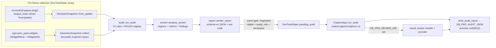

# Dev-Tools UI Audit Engine

Function-level documentation for the debug-build UI audit engine in
`crates/ui/src/dev_tools/`. The engine freezes one frame's widget geometry and
AccessKit semantics into owned snapshots, runs a registry of audit rules plus a
screen-level composition analyzer over them, and can emit a versioned JSON
report headlessly (`DB_PRO_AUDIT_JSON`). The whole module tree is compiled out
of release builds (`debug_assertions`).

Source files:

| File | Role |
|---|---|
| `mod.rs` | Inspector window, `DevToolsState` pipeline driver, fixtures, stderr dump |
| `geometry.rs` | Per-pass `WidgetRect`/`WidgetInfo` snapshot (layer-local coords) |
| `semantic.rs` | AccessKit `TreeUpdate` capture plugin + flattened snapshot |
| `audit.rs` | 12-rule audit engine (`run_audit`) |
| `screen.rs` | Screen-level composition analyzer (P10) |
| `report.rs` | Schema-v4 JSON serialization, baseline diff, exit-code policy |
| `visual_review.rs` | Opt-in AI review bundle + provider runner (P11) |

The headless emission driver lives outside the module in
`crates/native-app/src/capture.rs` (`CaptureApp::run_audit` /
`finish_audit`) and `crates/ui/src/app_lifecycle.rs`
(`take_audit_emission`, `write_audit_report`, `run_visual_review`).

## Pipeline

Warm/emission gate (`audit_pipeline_warm` in `mod.rs`): a report is emitted
only when `widget_count >= DB_PRO_AUDIT_READY` (default 1) **and**
(`stable_streak >= 2` consecutive equal layout fingerprints, or
`audit_frames > 30`) **and** (the `semantic.missing_name` rule evaluated at
least one node, or `audit_frames > 120`). The capture driver hard-stops with
exit code 2 after `AUDIT_TIMEOUT_FRAMES` = 180 frames.

## `mod.rs` — inspector + pipeline driver

Module docs note it is backed by egui 0.36 built-ins:
`Context::inspection_ui`, `DebugOptions`, `ViewportState::hits` /
`prev_pass.widgets`. Toggle: `mod+shift+i` or `DB_PRO_INSPECTOR`.

### Env constants

| Constant | Env var | Effect |
|---|---|---|
| `OPEN_ON_START_ENV` | `DB_PRO_INSPECTOR` | Opens inspector on first frame (non-empty, non-`0`). |
| `PICK_ENV` | `DB_PRO_INSPECTOR_PICK` | `"x,y"` in window points — programmatic widget pick for capture runs. |
| `AUDIT_FIXTURE_ENV` | `DB_PRO_INSPECTOR_AUDIT_FIXTURE` | Paints deliberately-broken fixture (overlap + zero-size). |
| `AUDIT_DUMP_ENV` | `DB_PRO_INSPECTOR_DUMP` | One-shot stderr dump of all issues once the pipeline is warm. |

(`DB_PRO_AUDIT_*` env names live in `report.rs` / `screen.rs`; there is no
`DB_PRO_AUDIT_DUMP` — the stderr dump knob is `DB_PRO_INSPECTOR_DUMP`.)

### Types / functions

- `inspector_id() -> egui::Id` — window id `"dbpro_dev_tools_inspector"`;
  its layer is filtered out of every geometry listing and pick.
- `DevToolsState` — fields: `open`, `selected: Option<SelectedWidget>`,
  `pending_pick: Option<Pos2>`, `audit` / `prev_audit` (current + previous
  `AuditReport` for new/resolved diffs), `audit_dumped`,
  `audit_frames` (frames audited since open), `pending_audit:
  Option<(Value, i32)>` (headless emission), `fixture_painted` (visual-review
  provenance — set by actual fixture paint, not env), `stable_streak`.
- `parse_pick_env()` — parses `PICK_ENV` `"x,y"` → `Pos2`; `None` on any
  malformed component.
- `DevToolsState::draw(ctx, theme)` — the pipeline entry point, called every
  frame. When `DB_PRO_AUDIT_JSON` is set it runs "headless" (window closed,
  same snapshots and rules). Order per frame: paint audit/screen fixtures if
  enabled → `AccessKitCapture::ensure_installed` + `latest` →
  `GeometrySnapshot::collect` → `update_selection` → `paint_highlight` →
  `audit::run_audit` → `audit_pipeline_warm` → `maybe_dump_audit` →
  `maybe_emit_headless` → rotate `prev_audit`/`audit` → draw inspector window
  if open.
- `take_audit_emission()` — consumes `pending_audit`; the capture driver polls
  it each frame.
- `fixture_provenance()` — true once a synthetic fixture actually painted.
- `audit_pipeline_warm(report)` — see warm gate above. One matching
  fingerprint is not enough because snapshots describe the *previous* pass.
- `maybe_dump_audit(report, snapshot, warm)` — fires `dump_audit_issues` once,
  only when warm.
- `maybe_emit_headless(report, ctx, warm, theme)` — when warm and
  `DB_PRO_AUDIT_JSON` is non-empty: builds `ReportContext` (viewport from
  `DB_PRO_WINDOW_SIZE`, scenario default `"shell"`, theme label Dark/Light),
  renders JSON, optionally attaches `baseline` diff via `DB_PRO_AUDIT_BASELINE`,
  stores `(json, report::exit_code(report))`.
- `update_selection` — Escape clears; pending env pick retries until the
  widget registers next pass; primary press picks via
  `GeometrySnapshot::pick`; `selected.live` re-resolves by id every frame.
- `paint_highlight` — strokes the live rect red (`255,60,60`), the interact
  rect amber (`255,171,0`) when it differs (clipped), and labels the id.
- `section(title)` — `"🔧 {title}"` strong heading.
- `draw_debug_paint_toggles` — live checkboxes for egui `Options`/`Style.debug`;
  mutates a clone and writes back (drawing inside `all_styles_mut` deadlocks).
- `draw_selected_section` / `draw_geometry_detail` / `row` — pinned-selection
  detail UI: identity, geometry, clipping, semantics.
- `draw_widget_hits` / `draw_hit_row` — widgets under the pointer from the
  prev-pass hit test (inspector excluded), top widget last.
- `audit_fixture_enabled()` — `DB_PRO_INSPECTOR_AUDIT_FIXTURE` non-empty/non-`0`.
- `paint_audit_fixture(ctx)` — one `Area` containing two buttons whose
  hitboxes overlap >50% without containment, plus a zero-size interactive
  widget; deterministic evidence for `overlap.suspicious` +
  `interactive.zero_size`.
- `screen_fixture_mode()` — `DB_PRO_AUDIT_SCREEN_FIXTURE` value (`ugly` =
  intentional defects, any other non-empty = clean layout); `None` when unset.
- `paint_screen_fixture(ctx, mode)` — a miniature IDE layout (top bar, side
  rail, content column, status bar) inside `SCREEN_FIXTURE_RECT` on layer
  `screen_fixture_layer_id()`; per-zone `new_child` UIs give each zone a real
  `parent_id` so the analyzer sees pane structure. `ugly` adds a dominant
  rail, an outlier gap, and an off-screen widget.
- `fixture_place` / `paint_fixture_zone` / `fixture_offscreen_widget` —
  fixture helpers: `allocate_rect` + `widget_info` registers a named
  interactive widget inside a zone; `fixture_offscreen_widget` places an
  interactive widget fully outside the fixture screen.
- `draw_audit_section` — per-rule PASS/FAIL/SKIP/N-A tallies + clickable
  issue list (click pins the widget; new/resolved diff vs `prev_audit` shown
  when snapshots are equivalent).
- `draw_screen_section` — screen metrics + screen findings rendered muted
  (informational; never severity-colored, never gating).
- `draw_issue_row` — one issue line: severity color, rule, widgets, evidence.
- `dump_audit_issues(report, snapshot)` — one line per issue to stderr for
  `DB_PRO_INSPECTOR_DUMP`; stderr is the interface for that env.

## `geometry.rs` — widget snapshot

Rects are stored **layer-local** (egui's own units); consumers call
`to_global_rect` to apply the layer transform. `clipped` is *derived*:
`interact_rect != rect` because egui pre-clips interact rects to the parent
clip. No parent tree is synthesized — `parent_id` is the real parent Ui id.

- `GeometryRect { min_x, min_y, max_x, max_y }` — owned rect; `from_egui`,
  `to_egui`, `width`, `height`.
- `WidgetGeometry` — one widget: `id` + `id_debug`, `parent_id` +
  `parent_debug`, `layer` + `layer_debug`, `rect`, `interact_rect`,
  `clipped`, `senses_click`, `senses_drag`, `focusable`, `enabled`, and
  `WidgetInfo` fields (`widget_type`, `label`, `hint_text`,
  `current_text_value`, `selected`, `value`).
  - `WidgetGeometry::from_egui(widget, info)` — flatten one `WidgetRect` +
    optional `WidgetInfo`.
  - `to_global_rect(ctx)` — `ctx.layer_transform_to_global(layer)` applied to
    `rect`; identity fallback for untransformed layers.
- `GeometrySnapshot { layers: Vec<(LayerId, Vec<WidgetGeometry>)> }` —
  grouped by layer, sorted front-most `Order` first.
  - `collect(ctx, exclude_area)` — freezes `prev_pass.widgets` for the
    viewport, dropping the inspector's layer (`is_area_layer`).
  - `pick(ctx, pos)` — topmost enabled widget whose (layer-local, after
    `layer_transform_from_global`) `interact_rect` contains `pos`; iterates
    layers front-to-back and widgets in reverse paint order; `Tooltip` and
    `Debug` orders can't receive clicks and are skipped.
  - `find(id)` — re-resolve a widget across frames (scroll/resize-safe pin).
- `SelectedWidget { picked, live }` — pinned selection; `current()` prefers
  `live`, falls back to the pick-time geometry.
- `is_area_layer(layer, area)` — layer membership test used to self-exclude
  the inspector (`layer.id == area && order == Middle`).
- `transform_debug(ctx, layer)` — `"scale … offset …"` or `"identity"`.

## `semantic.rs` — AccessKit capture

egui emits `accesskit::TreeUpdate` in `PlatformOutput::accesskit_update`
only while accesskit is enabled (`Context::enable_accesskit`, sticky). The
join between geometry and semantics is `egui::Id`: egui builds node ids via
`Id::accesskit_id` (`id.value().into()`), so the u64 payload inverts
verbatim.

- `AccessKitCapture` — egui `Plugin` holding `Mutex<Option<TreeUpdate>>`.
  - `output_hook` clones (not takes) each pass's update into `latest` —
    real assistive-tech delivery stays intact; a poisoned mutex drops the
    frame (rules skip rather than guess).
  - `ensure_installed(ctx)` — idempotent `enable_accesskit` + `add_plugin`.
  - `latest(ctx)` — clone of the most recent captured tree.
- `SemanticNode` — flattened node: `widget_id` (`None` for the root window
  node), `node_id`, `role` + `role_debug`, resolved `name`, `disabled`,
  `hidden`, `supports_click`, `supports_focus`, `parent`.
- `SemanticSnapshot { nodes: HashMap<NodeId, SemanticNode>, focus }`.
  - `from_update(update)` — `None` when the update has no nodes. Builds
    `parent_of` from `children()` lists (the only structural truth — `Node`
    has no parent field). Name resolution order: `label` → `labelled_by`
    targets' label/value → `value` for `Role::Label`; whitespace-only names
    become `None`.
  - `find_widget(id)` — node lookup by egui `Id` via `id.accesskit_id()`.
- `u64_to_id(bits)` — `NodeId` payload → `Id` via
  `Id::from_high_entropy_bits`; `None` for zero.
- `is_name_required_role(role)` — roles demanding an accessible name:
  Button, CheckBox, RadioButton, ComboBox, Slider, SpinButton, TextInput,
  MultilineTextInput, Link, MenuItem, MenuItemCheckBox, MenuItemRadio, Tab,
  TreeItem, ListBoxOption, Switch, SearchInput, ColorWell, Splitter,
  ScrollBar, Cell, RowHeader, ColumnHeader.

## `audit.rs` — rule engine

Design contract: *evidence or silence* (every issue carries numbers + a
`Confidence`; missing data → `skipped`, never a guess), *layout is not a
bug* (containment, cross-layer overlays, and clipping are legal), *snapshots
are read-only*.

### Types

- `Confidence { High, Medium }` — High = self-contradictory geometry or a
  fully hidden widget; Medium = strong signal but legitimate layouts can
  produce it. `label()`: `"high"`/`"medium"`.
- `Severity { Warning, Error }` — triage ordering. `label()`:
  `"error"`/`"warning"`.
- `AuditIssue` — `rule_id`, `severity`, `confidence`, `widget_id` (typed, so
  the inspector can re-pin), `widget_debug`, `other_id` (pair rules),
  `evidence` (the numbers that fired it).
- `SkipReason { Clipped, IntentionalOverlay, NoSemanticTree, NonOpaqueColors }`.
- `RuleStats { evaluated, skipped, skip_reason, not_applicable }` —
  `not_applicable` (out of scope) is deliberately distinct from `skipped`
  (in scope, evidence missing).
- `Verdict { Pass, Fail, Skipped, NotApplicable }` — `label()` gives
  `"PASS"`/`"FAIL"`/`"SKIP"`/`"N/A"`.
- `RuleReport { rule_id, stats, issues }` — `verdict()`: issues>0 → Fail;
  evaluated>0 → Pass; only skips → Skipped; nothing → NotApplicable (zero
  evaluated is never PASS).
- `AuditReport` — `issues`, `rules`, `screen: Option<ScreenAnalysis>`,
  `widget_count`, `widget_ids: HashSet<u64>`, `layout_fingerprint`.
  - `equivalent_snapshot(other)` — same widget-id set.
  - `diff(prev)` — `(new, resolved)` issue-key sets; `None` unless
    snapshots are equivalent.
  - `issue_key` — `"rule|widget_debug|other_debug"`.

### Engine

- `type Rule = fn(&Context, &GeometrySnapshot, Option<&SemanticSnapshot>)
  -> (Vec<AuditIssue>, RuleStats)` — `semantic` is `None` when no tree
  exists; semantic rules must report skipped.
- `layout_fingerprint(snapshot)` — order-independent `DefaultHasher` over
  `(id.value(), rect × 2 as i64)` per widget — i.e. rects quantized to
  0.5 px. Equal on consecutive frames means the layout settled.
- `RULES` — registry in report order; adding an audit = one fn + one entry.
- `run_audit(ctx, snapshot, semantic)` — fills `AuditReport` (counts, id
  set, fingerprint), runs all 12 rules, then attaches
  `screen::analyze_screen(ctx, snapshot, semantic, &fixture_scope())`.
  Empty snapshot is valid → empty report.
- `no_semantic_data()` — whole-rule skip marker when no tree exists.

### Rules (12)

| Rule id | Severity | Confidence | Constants / contract |
|---|---|---|---|
| `geometry.invalid` | Error | High | Rect with NaN/±∞ component or `min > max`. Never skips. Evidence: `"non-finite rect …"` / `"inverted rect …×… (min > max)"`. |
| `interactive.zero_size` | Error | High | Enabled widget sensing click/drag/focusable with `interact_rect` < `MIN_HIT_SIZE` = **1.0 px** on either axis. Clipped → `Clipped` skip. Evidence: `"interactable {w}×{h}px < {1}px floor (rect …)"`. |
| `overlap.suspicious` | Warning | Medium/High | Same `layer.id` **and** `layer.order`, both enabled+interactive, interact rects intersect (global space) without containment. coverage = overlap ÷ smaller area; ≥ `OVERLAP_MED` = **0.5** flags, ≥ `OVERLAP_HIGH` = **0.9** → High. Skips: different layer/order → `IntentionalOverlay`; clipped → `Clipped`; same-parent accesskit `Splitter` pair → `IntentionalOverlay`. Zero-area → owned by `interactive.zero_size`. Evidence: `"{n}% of the smaller hitbox covered by a sibling widget (overlap W×Hpx)"`. |
| `semantic.missing_name` | Error | High | Node with `is_name_required_role`, or a name-agnostic role where **both** the node advertises Click and the widget senses_click, must have a name. Hidden → skip; no tree → whole-rule skip. Evidence: `"{role} node has no label / labelled_by / value"`. |
| `semantic.disabled_mismatch` | Warning | High | Interactive widget whose `enabled` disagrees with its node's `disabled` (both directions). Widget without node → `NoSemanticTree` skip; hidden node → `Clipped` skip. Evidence: `"widget enabled=… but semantic node disabled=…"`. |
| `semantic.orphan_node` | Error | High | Non-root node (has `widget_id`) not listed as anyone's child. Evidence: `"{role} node is not a child of any node in the update"`. |
| `focus.orphaned` | Error | High | `TreeUpdate.focus` not among the update's nodes. `focus == None` → skipped `NoSemanticTree`. Evidence: `"focus … is not a node in the tree update ({n} nodes)"`. |
| `focus.unfocusable` | Error | High | Focus lands on a non-root node lacking `Action::Focus`. Root window node exempt; focus absent from nodes is left to `focus.orphaned`. Evidence: `"focus is on a {role} node without Action::Focus"`. |
| `visual.typography_hierarchy` | Warning | High | `Style::text_styles` of the active theme: Heading > Body, Body ≥ Small, Button ≥ Small. Missing style → skip. Issues carry `Id::NULL`/`"style"`. Evidence: `"{contract}: {style}={px}pt ≤ {style}={px}pt"`. |
| `visual.text_contrast` | Error | High | WCAG 2.x ratio vs `WCAG_AA_NORMAL` = **4.5** on 4 active-theme token pairs: noninteractive fg on `panel_fill`, on `window_fill`, inactive fg on `weak_bg_fill`, hovered fg on `weak_bg_fill`. Non-opaque color → `NonOpaqueColors` skip; disabled and active widget states excluded by design. Evidence: `"{what}: {r}:1 < 4.5:1 AA (fg #… on bg #…)"`. |
| `visual.touching_controls` | Warning | Medium | Same `(layer.id, parent_id)` group of unclipped enabled click-sensing widgets, vertically stacked with x-overlap and gap in `[0, TOUCHING_GAP_PX)` = **1.0 px**. `Foreground`/`Tooltip`/`Debug` orders → `IntentionalOverlay` skip. Negative gaps belong to `overlap.suspicious`. Evidence: `"{g}px gap between stacked controls (< 1px)"`. |
| `visual.alignment_drift` | Warning | Medium | Column (x-overlapping, y-sorted) of ≥3 same-group widgets; modal `min_x` in ±0.5 px buckets; a member off by `(DRIFT_MIN_PX, DRIFT_MAX_PX]` = **0.5–4.0 px** is drift. <3 members → `not_applicable`; no majority or perfectly aligned → no issue. Evidence: `"left edge {d}px off the column's shared edge ({x}), within the 0.5–4px drift band"`. |

Helpers: `contrast_ratio(fg, bg)` — WCAG relative-luminance ratio, `None`
unless both colors are fully opaque; `interactive_sibling_groups(snapshot)` —
`(layer.id, parent_id)` groups of ≥2 enabled, click-sensing, unclipped
widgets; `unknown_issue_id()` — `Id::NULL`; `u64_to_issue_id(node_id)` —
`NodeId` → `Id` for focus issues (`Id::NULL` on zero bits).

## `screen.rs` — screen-level analyzer (P10)

Consumes the same snapshots plus a viewport/scope, emits `ScreenAnalysis`:
measured metrics + a separate `findings` list that never joins
`AuditReport.issues` and never gates the exit code. Contract: internal
consistency only (no generic standards), every finding tagged
objective/heuristic, missing data = UNKNOWN (`None` + `gaps`), IDE-aware
(dense data grids exempt from density findings). Screenshots/pixels are out
of scope.

### Constants

| Name | Value | Guards |
|---|---|---|
| `SCREEN_FIXTURE_ENV` | `"DB_PRO_AUDIT_SCREEN_FIXTURE"` | `ugly` = defects; other non-empty = clean layout. |
| `SCREEN_FIXTURE_RECT` | (60,60)→(920,620) | Virtual screen for the fixture; fits in 800×600 viewport. |
| `SEAM_MIN_PX` | 0.5 | Min whitespace corridor that splits regions. |
| `REGION_MERGE_GAP` | 24.0 | Max gap inside a mergeable same-parent region. |
| `EDGE_TOL_PX` | 16.0 | Distance from screen edge that still counts edge-anchored. |
| `PANEL_MIN_HEIGHT_SHARE` | 0.3 | Min screen-height share for an interior side panel. |
| `PANEL_MAX_WIDTH_SHARE` | 0.45 | Max screen-width share for rails/panels. |
| `BAR_MAX_THICKNESS_SHARE` | 0.2 | Max height share for top/status bars. |
| `GRID_MIN_ITEMS` | 8 | Min same-size siblings for grid signature. |
| `UNIFORM_TOL_PX` | 1.0 | "Same size" tolerance for siblings. |
| `RHYTHM_MAJORITY` | 0.6 | Share of gaps at the mode required for a dominant rhythm. |
| `OUTLIER_FLAT_PX` | 8.0 | Outlier floor: `mode + 8px`. |
| `OUTLIER_MULT` | 4.0 | Outlier floor: `mode × 4` (both must hold — floor is the max). |
| `SECONDARY_MAX_SHARE` | 0.5 | Max width share for left-anchored secondary panes before inversion. |
| `PRIMARY_MIN_REGIONS` | 6 | Min regions before `no_primary_region` can fire. |
| `PRIMARY_MIN_SHARE` | 0.15 | Min largest-region share that counts as a working surface. |
| `CONGESTION_GAP_PX` | 2.0 | "Packed" neighbor distance on both axes. |
| `CONGESTION_MIN_WIDGETS` | 10 | Min leaf interactives / packed count for congestion. |
| `SEMANTIC_MIN_NODES` | 24 | Min tree size before flat-semantics applies. |
| `SEMANTIC_CONTAINER_MIN_RATIO` | 0.05 | Min container-role share on a large screen. |
| `OFFSCREEN_MARGIN_PX` | 1.0 | Tolerance before a rect counts as outside the viewport. |

(Ad-hoc constants inside functions: grid size signature ≥75% same-size;
banding ≥2 stripes of ≥4 covering ≥60%; stride pitch ≥75% modal;
congestion stacked-bar exemption ≥3 bands of ≥4 covering ≥50% in 8 px
buckets; congestion requires ≥80% of ≥10 leaves packed; toolbar-frame
exemption band = `max(15% height, 24px)`; `no_primary` requires interactive
coverage ≥0.15; coverage grid capped at 8,000,000 cells; hierarchy depth
cycle guard 64; side rail classification requires height share ≥0.5;
`can_merge` requires ≥50% cross-axis overlap.)

### Types

- `ScreenScope { Full, Fixture { layer, rect } }` — `Full`: all widgets,
  screen = `ctx.content_rect()`; `Fixture`: only widgets on the fixture
  layer, screen = `SCREEN_FIXTURE_RECT`.
- `screen_fixture_layer_id()` — `LayerId(Middle, "dbpro_screen_audit_fixture")`.
- `FindingKind { Objective, Heuristic }` — geometric fact vs consistency
  signal.
- `ScreenFinding` — `rule` (e.g. `"screen.spacing_outlier"`), `kind`,
  `severity`, `confidence`, optional `widget_id`/`widget_debug`, optional
  `region` index, `evidence`.
- `RegionKind { TopBar, StatusBar, LeftRail, RightPanel, SidePanel, Dialog,
  Content }` — `label()` gives snake_case.
- `ScreenRegion` — `kind`, bounding `rect`, `widgets`, `interactive`,
  `grid_like`, `screen_share`, `fill` (union/bbox tightness), `floating`
  (majority off the dominant layer).
- `RhythmStats { gaps_measured, mode_gap, mode_share, outliers }`,
  `DensityStats { widgets, interactive, interactive_coverage,
  widget_coverage }`, `BalanceStats` (4 quadrant shares of interactive
  area), `HierarchyStats { max_depth, containers, nodes }` (all `Option`,
  `None` = UNKNOWN).
- `AnalysisGap { NoSemanticTree, NoGeometry, AllClipped }`.
- `ScreenAnalysis { sufficient, regions, rhythm, density, balance,
  hierarchy, findings, gaps }`.

### Entry point and passes

- `analyze_screen(ctx, snapshot, semantic, scope)` —
  1. Resolve scope → `(screen_rect, widgets)`; convert to global rects,
     drop non-finite/inverted.
  2. `usable` = unclipped, non-overlay (`Foreground`/`Tooltip`/`Debug`
     excluded — they weld seams), and interactive-or-semantic widgets.
     Gaps: `NoGeometry`, `AllClipped` (sets `sufficient = false`),
     `NoSemanticTree`.
  3. Coverage via a 1 px occupancy grid over the screen bounds
     (`mark_cells`); skipped silently above 8 M cells.
  4. Quadrant balance of interactive rect area.
  5. `detect_regions` → `measure_hierarchy` → `measure_rhythm`.
  6. Findings (only when `sufficient`, except `finding_flat_semantics`
     which runs whenever a tree exists): `off_screen`, `layout_inversion`,
     `no_primary`, `dialog_offscreen`, `spacing_outliers`, `congestion`,
     `flat_semantics`.
- `mark_cells` — clamp-and-fill occupancy cells for a rect.

### Region detection: whitespace XY-cut + parent merge

- `xy_cut(widgets, group, x_axis, out)` — recursive alternating-axis split
  until no seam ≥ `SEAM_MIN_PX` exists.
- `split_on_seam` — largest whitespace corridor along one axis by scanning
  the sorted interval union; takes the *widest* corridor, not the first.
- `can_merge(a, b)` — merges leaf groups sharing a `parent_id` when some
  cross pair is within `REGION_MERGE_GAP` on one axis with ≥50% overlap on
  the other. Cannot cross structural boundaries.
- `detect_regions` — XY-cut leaves → fixpoint merge → per-region bounding
  box, dominant-layer floating flag, `classify`, `is_grid_like`; sorted by
  `screen_share` descending.
- `classify` — precedence (first match wins): floating non-edge → Dialog;
  top edge + h ≤ 0.2 → TopBar; bottom edge + h ≤ 0.2 → StatusBar; left edge
  + h ≥ 0.5 + w ≤ 0.45 → LeftRail; right edge same → RightPanel; interior
  h ≥ `PANEL_MIN_HEIGHT_SHARE` + w ≤ `PANEL_MAX_WIDTH_SHARE` + not floating
  → SidePanel; floating → Dialog; else Content.
- `is_grid_like` — any of three signatures:
  - `grid_size_signature`: ≥`GRID_MIN_ITEMS` members, modal rect size
    (0.5 px buckets) ≥75% of members.
  - `grid_banding_signature`: ≥2 stripes (shared `min_y` or `min_x` line,
    ≥4 each, 0.5 px buckets) covering ≥60%.
  - `grid_stride_signature`: same-parent run of ≥8 siblings uniform in
    height (or width) within `UNIFORM_TOL_PX`, with ≥75% of positive
    pitches equal to the modal pitch (±1 px).

### Metrics

- `measure_hierarchy` — deepest parent chain (cycle guard 64), count of
  container roles (Pane, GenericContainer, ScrollView, Group, List, Table,
  Tree, Toolbar, TabPanel, MenuBar), node total. `None` without a tree.
- `sibling_gaps` — for each `(LayerId, parent_id)` group: consecutive
  x-overlapping pairs in y order (vertical gaps) and y-overlapping pairs in
  x order (horizontal gaps). Returns `(gap, id_a, id_b, horizontal)`.
- `measure_rhythm` — mode of positive gaps in 0.5 px buckets (running
  average per bucket); `outliers` counts gaps above
  `max(mode×OUTLIER_MULT, mode+OUTLIER_FLAT_PX)`.

### Findings

| Rule | Kind | Sev/Conf | Fires when | Evidence |
|---|---|---|---|---|
| `screen.off_screen` | Objective | Warn/High | Enabled click/drag, unclipped widget rect exceeds the viewport by > `OFFSCREEN_MARGIN_PX`. | `"interactive rect (x,y)→(x,y) exceeds viewport (W×H)"` |
| `screen.layout_inversion` | Objective | Warn/High | Widest **left-anchored** pane (h ≥ 0.3 share, not touching top/bottom edges — full-width bands are docks) exceeds `SECONDARY_MAX_SHARE` of width and is wider than the widest non-left region. Right-side inversion is undetectable by design. | `"left-anchored pane is {w}px wide ({p}% of screen) vs the widest non-left region at {w}px"` |
| `screen.no_primary_region` | Objective | Warn/Medium | ≥ `PRIMARY_MIN_REGIONS` regions, interactive coverage ≥ 0.15, largest region < `PRIMARY_MIN_SHARE`. | `"largest region covers {p}% of the screen across {n} regions — no dominant work surface"` |
| `screen.dialog_offscreen` | Objective | Warn/Medium | A `Dialog` region overflows the viewport by > `OFFSCREEN_MARGIN_PX`. | `"dialog region (x,y)→(x,y) overflows the viewport by {n}px"` |
| `screen.spacing_outlier` | Heuristic | Warn/Medium | Same-(layer,parent) group of ≥4, cross-axis-uniform run, ≥3 gaps, dominant rhythm (mode share ≥ `RHYTHM_MAJORITY`), an **interior** gap > `max(mode×4, mode+8px)`. Edge gaps are anchoring, not deviation. | `"{g}px gap vs the run's dominant {m}px rhythm ({p}% of {n} uniform siblings)"` |
| `screen.control_congestion` | Heuristic | Warn/Medium | Non-grid `Content` region: ≥10 leaf interactives (drops strict containers and duplicate rects), no stacked-bar banding exemption, ≥80% of ≥10 leaves having a ≤`CONGESTION_GAP_PX` neighbor on **both** axes, packed set not all within the top/bottom 15% (min 24 px) frame band. | `"{p} of {n} interactive widgets packed within 2px on both axes in a non-data region"` |
| `screen.flat_semantics` | Heuristic | Warn/Medium | Tree has ≥ `SEMANTIC_MIN_NODES` nodes and container-role nodes < `SEMANTIC_CONTAINER_MIN_RATIO`. No tree → absent (gap already records it). | `"{n} semantic nodes but only {c} container-role nodes (<5%) — flat AT structure"` |

- `dominant_gap(positive)` — modal positive gap in 0.5 px buckets →
  `(mode, count)`.
- `fixture_scope()` — `ScreenScope::Fixture` when `DB_PRO_AUDIT_SCREEN_FIXTURE`
  is non-empty/non-`0`, else `Full`.

## `report.rs` — JSON report + exit policy

`SCHEMA_VERSION = 4` — v2 added `scenario` + `layout_fingerprint`; v3 the
`screen` section; v4 `visual_review`. Baseline loaders check the version
first.

### Env constants

| Const | Env | Meaning |
|---|---|---|
| `OUTPUT_ENV` | `DB_PRO_AUDIT_JSON` | Output path; non-empty enables headless mode. |
| `BASELINE_ENV` | `DB_PRO_AUDIT_BASELINE` | Baseline report for the signature-gated diff. |
| `SCENARIO_ENV` | `DB_PRO_AUDIT_SCENARIO` | Scenario name (default `"shell"`), part of the signature. |
| `READY_ENV` | `DB_PRO_AUDIT_READY` | Min widget count before emitting. |
| `FAIL_ON_ENV` | `DB_PRO_AUDIT_FAIL_ON` | Comma-separated fail policy tokens. |

Exit codes: `EXIT_OK` = 0, `EXIT_AUDIT_FAILED` = 1 (any FAIL verdict or
Error issue), `EXIT_TOOL_ERROR` = 2 (IO/timeout/etc.).

### Types / functions

- `Signature { schema_version, scenario, fixture, viewport, theme,
  widget_ids }` — reports diff only when signatures agree.
- `IssueKey { rule, widget, other }` — `of(issue)`, `line()` →
  `"rule|widget|other"`.
- `ReportContext { viewport, fixture, frames, scenario, theme_label }` —
  caller-supplied inputs the report can't derive.
- `render_report(report, ctx, rc)` — pure; emits `{schema_version, meta,
  signature, summary, rules, issues, screen}`.
- `report_signature`, `report_rules_json` (`{id, verdict, issues,
  coverage:{evaluated, skipped, skip_reason, not_applicable}}`),
  `report_issues_json` (`{key, rule, severity, confidence, widget, other,
  evidence}`), `report_meta` (tool/binary/viewport/theme/scenario/fixture/
  frames/fingerprint/fail_policy/os/timestamp), `report_summary`
  (widget/rule/issue/error/warning counts + verdict tallies).
- `render_screen(analysis)` — `sufficient`, `coverage.gaps` +
  `semantic_available`, `metrics.{regions, rhythm, density,
  balance.interactive_area_share, hierarchy}`, `findings`. `null` fields
  mean UNKNOWN.
- `BaselineDiff { Comparable { new, resolved }, NotComparable { reason } }`
  — `to_json` into the report's `baseline` section.
- `diff_with_baseline(path, signature, current_keys)` — IO errors → `Err`
  (tool error); schema mismatch, missing/invalid signature, or any
  signature-field disagreement → `NotComparable` with a reason naming the
  first mismatch; otherwise key-set diff (sorted).
- `issue_keys(report)` — `HashSet` of `IssueKey::line()` strings.
- `FailPolicy { on_warnings, on_objective_screen }` — `from_env` parses
  `DB_PRO_AUDIT_FAIL_ON`: `error` (default, no-op token), `warning`,
  `screen`; unknown tokens warn. `label()` → e.g. `"error,warning,screen"`.
- `exit_code_with_policy(report, policy)` — 1 iff any rule FAILs, any
  Error issue, (policy) any Warning, or (policy) any `Objective` screen
  finding. Heuristic screen findings, SKIP/N/A, and AI review output never
  gate.
- `exit_code(report)` — env-configured policy.

## `visual_review.rs` — AI review (P11)

Opt-in second opinion. `DB_PRO_REVIEW_DIR` set → the capture driver writes a
bundle (`<dir>/<scenario>.bundle.json`) + screenshot (`<dir>/<scenario>.png`)
and optionally invokes a provider. Output lands in `visual_review`, never in
`issues` or the exit code. Privacy: unset dir → nothing written; bundle is
key-whitelisted (no labels/text/credentials); screenshot gated by
provenance.

### Env constants

| Const | Env | Default |
|---|---|---|
| `REVIEW_DIR_ENV` | `DB_PRO_REVIEW_DIR` | unset → off |
| `PROVIDER_CMD_ENV` | `DB_PRO_AI_REVIEW_CMD` | unset → bundle only |
| `MODEL_ENV` | `DB_PRO_AI_REVIEW_MODEL` | forwarded as `DB_PRO_REVIEW_MODEL` |
| `TIMEOUT_ENV` | `DB_PRO_AI_REVIEW_TIMEOUT` | 60 s |

### Types / functions

- `ReviewVerdict { Ok, Attention, Poor }`, `ReviewCategory { Hierarchy,
  Typography, Spacing, Balance, Density, Consistency, Clarity, Other }`,
  `ObservationKind { Observation, Suggestion }` — all `snake_case` serde.
- `VisualReview { provider, model?, verdict?, summary?, observations }` —
  provider output contract; unknown fields ignored, malformed required
  fields fail the review.
- `Observation { category, kind, severity="info", confidence="medium",
  rect?, evidence, recommendation? }`.
- `parse_review(raw)` — validates JSON plus per-observation non-empty
  `evidence` and vocab (`severity` ∈ info|warning, `confidence` ∈
  high|medium|low). Errors are strings, never panics.
- `BUNDLE_KEYS` = `["schema_version", "meta", "summary", "rules",
  "issues", "screen"]` — the whitelist; new report fields do NOT pass
  through automatically.
- `build_bundle(report, screenshot_file)` — `{bundle_version: 1, tool,
  context: "database-ide", screenshot, report: excerpt, instructions}`
  including the provider's output schema and ground rules.
- `ReviewOutcome { Completed(VisualReview), Failed(String), BundleOnly,
  Blocked(String) }` — `to_json(bundle, screenshot)` emits `status`
  completed|error|bundle_only|blocked.
- `screenshot_is_safe(live_connection, provenance)` — `!live || provenance`;
  provenance comes from a fixture actually painting, never an env string.
- `run_provider(bundle_path)` — `BundleOnly` when `DB_PRO_AI_REVIEW_CMD` is
  unset/empty; otherwise `run_command` then `parse_review` →
  `Completed`/`Failed`.
- `run_command(cmd, path, timeout)` — `sh -c "<cmd> \"$1\""` with the
  bundle path as `$1`; stdout captured on a side thread (pipe-deadlock
  safe), stderr inherited; kill + error on timeout.
- `bundle_path` / `screenshot_path` — `<dir>/<scenario>.bundle.json` /
  `.png`.

## Headless capture driver (outside `dev_tools`)

`crates/native-app/src/capture.rs` (`CaptureApp`, debug-only audit path):

- `AUDIT_ENV` = `DB_PRO_AUDIT_JSON` → `audit_requested()`; shares
  `SIZE_ENV` = `DB_PRO_WINDOW_SIZE` (`"WxH"` pinned viewport) and the
  fixture env vars with screenshot capture.
- `AUDIT_TIMEOUT_FRAMES` = 180 — bail with exit 2 if the pipeline never
  warms.
- `run_audit(ctx)` — stage 1: poll `inner.take_audit_emission()`; when
  `DB_PRO_REVIEW_DIR` is set, park the emission in `pending_review` and
  request a `ViewportCommand::Screenshot` (stage 2 waits for the frame,
  retrying until `AUDIT_TIMEOUT_FRAMES`). Otherwise writes and exits.
- `finish_audit(json, code, shot_ok)` — attach `visual_review` via
  `inner.run_visual_review`, `write_audit_report`, `process::exit(code)`.
- `app_lifecycle.rs`: `take_audit_emission` (delegates to dev tools),
  `write_audit_report` (pretty-prints to `DB_PRO_AUDIT_JSON`; missing env
  or write failure → exit 2), `audit_scenario()`, `run_visual_review`
  (bundle write → `screenshot_is_safe(has_live_connection,
  fixture_provenance)` gate → `run_provider`).

`tools/ui-audit-matrix.sh` runs the matrix: per-scenario
`DB_PRO_AUDIT_JSON`/`DB_PRO_AUDIT_SCENARIO`/`DB_PRO_WINDOW_SIZE` plus
surface env (`DB_PRO_CAPTURE_*`, `DB_PRO_AUDIT_READY`, fixture envs) under a
120 s `timeout` on X11 (`WINIT_UNIX_BACKEND=x11`); status per scenario =
pass / fail (exit 1) / tool error (2, 124) / unsupported (no JSON). Results
land in `results.tsv` and a matrix JSON.

## Env knob summary

| Variable | Module | Purpose |
|---|---|---|
| `DB_PRO_AUDIT_JSON` | report / capture driver | Headless mode + report output path. |
| `DB_PRO_AUDIT_SCENARIO` | report | Scenario name in meta/signature (default `shell`). |
| `DB_PRO_AUDIT_READY` | report / mod.rs | Min widget count warm gate (default 1). |
| `DB_PRO_AUDIT_BASELINE` | report / mod.rs | Baseline file for signature-gated diff. |
| `DB_PRO_AUDIT_FAIL_ON` | report | `error` (default), `warning`, `screen` tokens. |
| `DB_PRO_AUDIT_SCREEN_FIXTURE` | screen / mod.rs | `ugly`/`good` virtual screen fixture + analyzer scope. |
| `DB_PRO_INSPECTOR` | mod.rs | Open inspector on start. |
| `DB_PRO_INSPECTOR_PICK` | mod.rs | `"x,y"` programmatic widget pick. |
| `DB_PRO_INSPECTOR_AUDIT_FIXTURE` | mod.rs | Paint broken-geometry fixture. |
| `DB_PRO_INSPECTOR_DUMP` | mod.rs | One-shot stderr issue dump when warm. |
| `DB_PRO_REVIEW_DIR` | visual_review / app_lifecycle | Opt-in review bundle directory. |
| `DB_PRO_AI_REVIEW_CMD` | visual_review | Provider command (bundle path on `$1`). |
| `DB_PRO_AI_REVIEW_MODEL` | visual_review | Model selector → `DB_PRO_REVIEW_MODEL`. |
| `DB_PRO_AI_REVIEW_TIMEOUT` | visual_review | Provider timeout secs (default 60). |
| `DB_PRO_WINDOW_SIZE` | capture.rs / mod.rs | Pinned viewport `"WxH"`; recorded as meta.viewport. |
