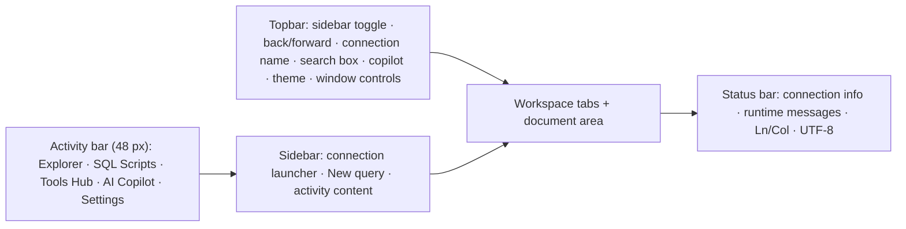

# Shell & Navigation

The DB Pro desktop window is organized into five fixed regions: a **topbar** at the top, an **activity bar** on the far left, a **sidebar** next to it, a **workspace tab strip + document area** in the center, and a **status bar** at the bottom. This page explains each region, how to move between screens, and how to manage connections.

## Topbar

The topbar (38 px) is always visible.

| Control | What it does |
|---|---|
| Sidebar toggle | Collapses or expands the sidebar (`Ctrl+B`; `⌘B` on macOS) |
| ← / → | Back / Forward through recently visited documents (disabled when there is nothing to go back/forward to) |
| Connection name | Shows the active connection with its driver badge (`PostgreSQL` or `SQLite`). Shows "DB PRO" when nothing is connected. On Linux, drag this area to move the frameless window; double-click to maximize/restore |
| Command Palette icon (⌘) | Opens the Command Palette (`Ctrl+Shift+P`) |
| Palette icon | Opens the Component Gallery (a built-in UI showcase; not needed for normal work) |
| Bot icon | Opens/closes the AI Copilot panel |
| Sun/Moon icon | Switches between dark and light theme |
| Search box ("Search commands, tables, schemas…") | Opens Quick Open (`Ctrl+P` / `Ctrl+K`) |
| Window controls | On Linux (frameless window): minimize, maximize/restore, close. The window also has custom resize handles on all edges and corners |

## Activity bar

The 48 px rail on the far left selects what the sidebar shows:

| Icon | Tooltip | What opens |
|---|---|---|
| 🗄 Database | Database Navigator | The Explorer: your saved connections and schema tree |
| 📄 File code | SQL Scripts & Projects | Saved queries, query history, and workspace files |
| 📦 Boxes | Tools & Management Hub | A launcher for schema compare, schema workbench, ER diagram, monitor, security, transfers, tasks, history, and problems |
| ✨ Sparkles | AI Copilot (Agent) | Toggles the agent side panel |
| ⚙ Settings (bottom of rail) | Settings | The Settings activity |

The active rail button is highlighted. Clicking a highlighted main activity again does not collapse the sidebar — use `Ctrl+B` or the topbar toggle instead.

## Sidebar

The sidebar sits between the activity bar and the document area. Drag its right edge to resize; `Ctrl+B` toggles it.

### Sidebar chrome (top of every activity)

- **Connection selector** — a pill showing the active connection name (or "DB Pro"). Clicking it opens the Command Palette, where the Connections scope lets you switch connection.
- **+ button** — New Connection (`Ctrl+N`).
- **New query** — a full-width button that creates a query document (`Ctrl+T`).

### Explorer (Database Navigator)

The Explorer lists saved connections under a **CONNECTIONS** header.

**Toolbar** (visible once you have at least one connection):

| Control | What it does |
|---|---|
| "Filter objects…" search box | Filters schema objects by name across the tree |
| Filter (list icon) | Opens the object-filter popup: a **Name match** mode plus per-kind checkboxes for **Tables, Views, Functions, Triggers**, and a **Reset** link. A dot on the button means a non-default filter is active |
| Refresh (rotate icon) | Re-introspects the active schema. Right-click shows the same action with its `F5` shortcut |

**Connection rows.** Each connection shows a status dot (green = connected, accent = connecting, red = failed, grey = disconnected) and a driver badge (`PG`, `SQLITE`, or `ERR` on failure). Clicking a disconnected row connects and expands it; clicking a connected row collapses/expands it. A failed connection shows "Failed: *error* — Click to retry"; a disconnected expanded row shows "Disconnected — click to connect".

**Right-click a connection** for:

- Disconnect / Connect, Reconnect, Refresh Schema (`F5`)
- SQL Editor / New Script (`Ctrl+T`)
- View ER Diagram
- Ask AI Agent about Database
- Open sample CREATE TABLE SQL…
- Copy Connection Name, Copy Connection String
- Edit Connection… (`F4`), Duplicate Connection, Delete Connection (`Del`, asks for confirmation)

**Schema tree.** Under a connected connection, the tree shows schemas, and inside each schema the folders **Tables**, **Views**, **Functions**, **Triggers** (folders hidden by the filter popup do not appear). Non-active schemas offer **Activate Schema** on right-click; every schema's context menu also has **View ER Diagram**, **Refresh Schema**, **Copy Schema Name**, and **Drop Schema…**.

**Table rows.** Right-click a table for: View Data, View Structure, Modify Table (Alter)…, Drop Table…, Generate SQL: SELECT \* / INSERT / UPDATE / DELETE, View DDL / CREATE Script, Copy Qualified Name, Copy Table Name, Ask Agent about table, Refresh Schema.

**Views / Functions / Triggers.** Right-click a view for Select Top 100 (Query), Open View, Modify View (Workbench)…, Drop View…, Copy View Name. Functions and triggers have equivalent menus; triggers additionally offer an enable/disable action when the server supports it.

**Empty / loading / error states:** with no connections the Explorer shows a "No connections" empty state with a **New connection** button. While the catalog loads it shows "Loading connections…"; a load failure shows the error message in red.

## Workspace tabs

Above the document area is a scrollable tab strip.

- **Welcome** — always available; quick-action cards for New Connection, New SQL Query, AI Copilot Assistant, and ER Diagram Canvas.
- **Query tabs** — one per SQL document. A spinning icon marks a running query; a dot marks unsaved changes.
- **Table tab** — appears when you select a table in the Explorer; shows a dot while staged data edits exist.
- **Schema object tab** — for the selected view/trigger/function.
- **Pinned tool tabs** — Results, ER Diagram, Schema Workbench, Schema Compare, Component Gallery appear only while open.
- **+ button** at the end — new query tab (`Ctrl+N` is also bound to New Connection — use `Ctrl+T` for a new query).

Right-click a tab for: Close Tab (`Ctrl+W`), Close Other Tabs, Close Tabs to the Right, Close All Tabs, Duplicate Tab, Copy SQL Content, Copy Title, and Run Query (`Ctrl+↵`). The table tab's menu instead offers Refresh Data, Copy Table Name, and Copy SELECT Query.

## Status bar

The 28 px bottom strip shows, left to right: a status icon and label, the connection name, driver, current database and schema, and a `Ping: N ms` latency readout when known. A transient runtime message (e.g. "Testing connection…", "Saving connection…") appears in the middle. On the right: `UTF-8`, `Ln X, Col Y` while an editor is focused (otherwise a context label), and a button to toggle the output panel.

## Palettes: Quick Open & Command Palette

Both open as a centered dialog (580 px) with a search field, a row of scope tabs — **All · Connections · Schema · Queries · Commands · Agent** — and a result list.

| Shortcut (Windows/Linux) | macOS | Action |
|---|---|---|
| `Ctrl+P` or `Ctrl+K` | `⌘P` / `⌘K` | Quick Open — "Switch workspaces, tabs, or open editors". Includes connections, tables/views/columns/functions, saved queries, history, workspace SQL files, and navigation entries |
| `Ctrl+Shift+P` | `⌘⇧P` | Command Palette — "Search commands, actions, and database tools" |

Inside the dialog: type to filter, `↑`/`↓` (or hover) to select, `↵` or click to activate, `Esc` to close. "No matching commands found" appears when nothing matches. Setting the scope to **Connections** turns the palette into a "Switch Connection" picker.

Quick Open navigation entries include Welcome, Query, Query history, Data, Files, ER diagram, Schema workbench, Schema compare, Transfers, Monitor, Settings, Agent, Problems, and Diagnostics. Command Palette entries include New query, Run query, Format SQL, New connection, Refresh schema, Pin/unpin selected table, Open Folder…, Close Workspace, Toggle explorer, Open Agent, Open ER diagram, Explain query, Export results, and Open Component Gallery. Rows backed by a rebindable command show the currently assigned shortcut.

## Keyboard shortcuts

Defaults below use `Ctrl`; on macOS `Ctrl` reads as `⌘`. All are rebindable in **Settings → Keybindings**.

| Shortcut | Command |
|---|---|
| `Ctrl+P` / `Ctrl+K` | Quick Open |
| `Ctrl+Shift+P` | Command Palette |
| `Ctrl+B` | Toggle Sidebar |
| `Ctrl+N` | New Connection |
| `Ctrl+T` | New Query |
| `Ctrl+W` | Close Tab |
| `Ctrl+O` | Open Table (selected table, else schema picker) |
| `Ctrl+S` / `Ctrl+Shift+S` | Save Query / Save Query As |
| `F5` | Run Query / Refresh Schema |
| `Ctrl+Shift+Enter` | Run Script (all statements) |
| `Ctrl+Shift+F` | Format Query |
| `Ctrl+F` | Find in Editor |
| `Ctrl+Shift+R` | Focus Results |
| `Ctrl+/` | Toggle Comment |
| `F4` | Edit Connection (context menu) |
| `Del` | Delete Connection (context menu) |
| `Esc` | Cancel running query → close query tools → close editor search → close agent panel (in that order) |

Shortcuts are suspended while a dialog (palette, connection form, delete confirmations) or the insert-row form is open.

## Connection dialog

Open with `Ctrl+N`, the **+** button in the sidebar, the Explorer empty state, or **Edit Connection…** from a connection's context menu. The dialog is titled **New Connection** or **Edit Connection** (820 px wide).

### Database engine picker

A dropdown of engine cards. Selectable today: **PostgreSQL** (Port 5432), **SQLite** (Embedded File), **MySQL** (Port 3306), **SQL Server** (Port 1433). Greyed-out entries (MariaDB, Azure SQL, Oracle, CockroachDB, Neon, Supabase, MongoDB, Redis, ClickHouse, Elasticsearch, Cassandra) are placeholders and cannot be selected.

### General

- **Connection Name** (required), **Folder / Group**, and a star toggle for **Favorite**.
- **Environment**: Development / Staging / Production / Custom. Choosing Production shows a "⚠ Production guard" hint.
- **Safety Policy**: **Read-only mode** checkbox.

### PostgreSQL / MySQL / SQL Server fields

Host, Port (required, 1–65535), Database Name (required), Username, Password/Access Token (blank keeps the saved password when editing), and an **SSL / TLS Mode** segmented control: Disable, Require, Verify CA, Verify Full — each mode shows a one-line guidance hint below it. Credentials are stored encrypted (AES-256-GCM) in the local vault.

Collapsible/advanced sections:

- **Cloud Presets & URI Importer** — presets for AWS RDS, AWS Aurora, Cloud SQL, and Azure Database (PostgreSQL/MySQL) with **Apply Preset**; an auth toggle (Password / Ephemeral token — tokens are session-only); and a "Paste Connection URI" field with **Import from URI** to fill the form from a `postgresql://…` URL.
- **SSL Certificates** — shown only for Verify CA / Verify Full: Root CA Certificate Path, Client Certificate (optional), Client Key (optional).
- **Connect via SSH Bastion Tunnel** — checkbox enables SSH Host, Port, SSH User, and private-key path with a Browse button; you can save the values as a reusable **SSH profile** or pick an existing profile. Note: the UI itself warns the tunnel is "Unqualified in v0.1: the tunnel has not been end-to-end tested and may not work reliably."
- **Tags & Metadata** — comma-separated tags.

### SQLite fields

Name/group/environment/safety as above, plus a required **Database File Path** with a **Browse File…** picker, and an info card noting that SQLite runs embedded in-process.

### Footer & feedback

- **Test Connection** runs a connectivity check; while testing it becomes **Cancel Test**. Success shows a green "Connection Verified" alert; failures show per-stage diagnostics lines (`OK`/`FAIL · stage · message`) above the form.
- **Save Connection** / **Update Connection** validates required fields first — invalid fields are marked inline (e.g. "Connection name is required", "Enter a port number from 1 to 65535").
- After you edit any field post-test, the dialog flags "Connection changed · test again before saving".
- **Cancel** closes the dialog; if a test is running it is cancelled first.

Deleting a connection (context menu → Delete Connection or `Del`) opens a confirmation dialog — the action warns it cannot be undone.
