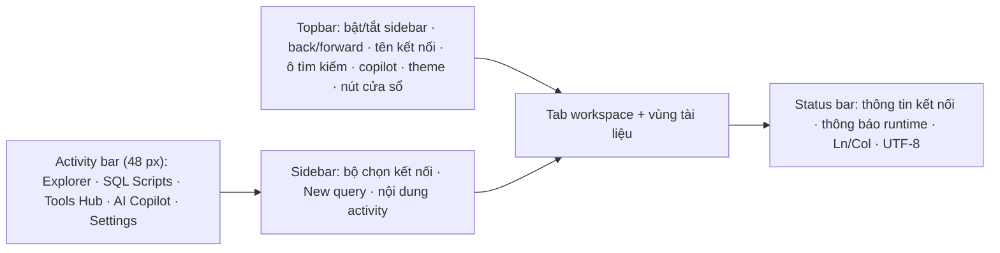

# Khung ứng dụng & Điều hướng

Cửa sổ DB Pro chia thành năm vùng cố định: **thanh topbar** ở trên cùng, **thanh activity bar** sát mép trái, **sidebar** kế tiếp, **dải tab workspace + vùng tài liệu** ở giữa, và **status bar** ở dưới cùng. Trang này giải thích từng vùng, cách di chuyển giữa các màn hình và cách quản lý kết nối.

## Topbar

Topbar (cao 38 px) luôn hiển thị.

| Nút | Chức năng |
|---|---|
| Bật/tắt sidebar | Thu gọn hoặc mở rộng sidebar (`Ctrl+B`; `⌘B` trên macOS) |
| ← / → | Quay lại / đi tới các tài liệu đã mở gần đây (bị mờ khi không còn gì để đi) |
| Tên kết nối | Hiển thị kết nối đang hoạt động kèm badge driver (`PostgreSQL` hoặc `SQLite`). Hiển thị "DB PRO" khi chưa kết nối. Trên Linux, kéo vùng này để di chuyển cửa sổ frameless; double-click để phóng to/khôi phục |
| Icon Command Palette (⌘) | Mở Command Palette (`Ctrl+Shift+P`) |
| Icon Palette | Mở Component Gallery (thư viện UI nội bộ; không cần cho công việc thường ngày) |
| Icon Bot | Mở/đóng panel AI Copilot |
| Icon Mặt trời/Mặt trăng | Chuyển giữa theme sáng và tối |
| Ô tìm kiếm ("Search commands, tables, schemas…") | Mở Quick Open (`Ctrl+P` / `Ctrl+K`) |
| Nút cửa sổ | Trên Linux (cửa sổ frameless): thu nhỏ, phóng to/khôi phục, đóng. Cửa sổ cũng có vùng kéo resize ở cả bốn cạnh và bốn góc |

## Activity bar

Thanh rail 48 px ở mép trái quyết định sidebar hiển thị nội dung gì:

| Icon | Tooltip | Mở ra |
|---|---|---|
| 🗄 Database | Database Navigator | Explorer: danh sách kết nối đã lưu và cây schema |
| 📄 File code | SQL Scripts & Projects | Query đã lưu, lịch sử query và file workspace |
| 📦 Boxes | Tools & Management Hub | Trình khởi chạy cho schema compare, schema workbench, ER diagram, monitor, security, transfers, tasks, history và problems |
| ✨ Sparkles | AI Copilot (Agent) | Bật/tắt panel agent bên cạnh |
| ⚙ Settings (cuối rail) | Settings | Activity Settings |

Nút rail đang chọn được tô sáng. Click lại vào activity đang chọn không thu gọn sidebar — hãy dùng `Ctrl+B` hoặc nút toggle trên topbar.

## Sidebar

Sidebar nằm giữa activity bar và vùng tài liệu. Kéo mép phải để đổi độ rộng; `Ctrl+B` để bật/tắt.

### Phần chrome (đỉnh của mọi activity)

- **Bộ chọn kết nối** — một pill hiển thị tên kết nối đang dùng (hoặc "DB Pro"). Click mở Command Palette; chuyển scope sang **Connections** để đổi kết nối.
- **Nút +** — tạo kết nối mới (`Ctrl+N`).
- **New query** — nút nguyên hàng tạo tài liệu query mới (`Ctrl+T`).

### Explorer (Database Navigator)

Explorer liệt kê các kết nối đã lưu dưới tiêu đề **CONNECTIONS**.

**Toolbar** (xuất hiện khi đã có ít nhất một kết nối):

| Nút | Chức năng |
|---|---|
| Ô "Filter objects…" | Lọc đối tượng schema theo tên trong toàn cây |
| Nút Filter (icon list) | Mở popup bộ lọc: chế độ **Name match** cùng checkbox từng loại **Tables, Views, Functions, Triggers** và liên kết **Reset**. Chấm trên nút nghĩa là đang có bộ lọc khác mặc định |
| Nút Refresh (icon xoay) | Nạp lại schema đang hoạt động. Chuột phải hiển thị cùng hành động kèm phím tắt `F5` |

**Hàng kết nối.** Mỗi kết nối có chấm trạng thái (xanh lá = đã kết nối, màu accent = đang kết nối, đỏ = lỗi, xám = ngắt) và badge driver (`PG`, `SQLITE`, hoặc `ERR` khi lỗi). Click hàng chưa kết nối sẽ kết nối và mở ra; click hàng đang kết nối sẽ đóng/mở. Kết nối lỗi hiển thị "Failed: *lỗi* — Click to retry"; hàng đã mở nhưng chưa kết nối hiển thị "Disconnected — click to connect".

**Chuột phải vào kết nối** để có:

- Disconnect / Connect, Reconnect, Refresh Schema (`F5`)
- SQL Editor / New Script (`Ctrl+T`)
- View ER Diagram
- Ask AI Agent about Database
- Open sample CREATE TABLE SQL…
- Copy Connection Name, Copy Connection String
- Edit Connection… (`F4`), Duplicate Connection, Delete Connection (`Del`, có hộp xác nhận)

**Cây schema.** Bên dưới kết nối đang mở, cây hiển thị các schema; trong mỗi schema là các thư mục **Tables**, **Views**, **Functions**, **Triggers** (thư mục bị ẩn bởi popup lọc sẽ không xuất hiện). Schema chưa active có mục **Activate Schema** trong menu chuột phải; mọi schema đều có **View ER Diagram**, **Refresh Schema**, **Copy Schema Name** và **Drop Schema…**.

**Hàng bảng.** Chuột phải vào bảng để có: View Data, View Structure, Modify Table (Alter)…, Drop Table…, Generate SQL: SELECT \* / INSERT / UPDATE / DELETE, View DDL / CREATE Script, Copy Qualified Name, Copy Table Name, Ask Agent about table, Refresh Schema.

**Views / Functions / Triggers.** Chuột phải vào view để có Select Top 100 (Query), Open View, Modify View (Workbench)…, Drop View…, Copy View Name. Function và trigger có menu tương tự; trigger còn có thao tác bật/tắt khi server hỗ trợ.

**Trạng thái trống / đang tải / lỗi:** chưa có kết nối nào thì Explorer hiển thị trạng thái "No connections" với nút **New connection**. Khi đang tải danh mục, Explorer hiển thị "Loading connections…"; nạp thất bại sẽ in thông báo lỗi màu đỏ.

## Tab workspace

Phía trên vùng tài liệu là một dải tab cuộn ngang được.

- **Welcome** — luôn có sẵn; các thẻ thao tác nhanh New Connection, New SQL Query, AI Copilot Assistant, ER Diagram Canvas.
- **Tab query** — mỗi tài liệu SQL một tab. Icon quay báo query đang chạy; chấm báo chưa lưu.
- **Tab bảng** — xuất hiện khi chọn bảng trong Explorer; có chấm khi còn thay đổi dữ liệu chưa ghi.
- **Tab schema object** — cho view/trigger/function đang chọn.
- **Tab công cụ** — Results, ER Diagram, Schema Workbench, Schema Compare, Component Gallery chỉ xuất hiện khi đang mở.
- **Nút +** ở cuối dải — tab query mới (`Ctrl+N` dành cho New Connection — dùng `Ctrl+T` để tạo query).

Chuột phải vào tab để có: Close Tab (`Ctrl+W`), Close Other Tabs, Close Tabs to the Right, Close All Tabs, Duplicate Tab, Copy SQL Content, Copy Title, và Run Query (`Ctrl+↵`). Menu của tab bảng thay bằng Refresh Data, Copy Table Name và Copy SELECT Query.

## Status bar

Dải 28 px dưới cùng hiển thị từ trái sang phải: icon và nhãn trạng thái, tên kết nối, driver, database và schema hiện tại, cùng độ trễ `Ping: N ms` khi đo được. Thông báo runtime tạm thời (ví dụ "Testing connection…", "Saving connection…") hiện ở giữa. Bên phải: `UTF-8`, `Ln X, Col Y` khi editor đang focus (nếu không thì hiển thị nhãn ngữ cảnh), và nút bật/tắt panel output.

## Quick Open & Command Palette

Cả hai mở dưới dạng dialog căn giữa (rộng 580 px) gồm ô tìm kiếm, hàng tab scope — **All · Connections · Schema · Queries · Commands · Agent** — và danh sách kết quả.

| Phím tắt (Windows/Linux) | macOS | Tác dụng |
|---|---|---|
| `Ctrl+P` hoặc `Ctrl+K` | `⌘P` / `⌘K` | Quick Open — "Switch workspaces, tabs, or open editors". Bao gồm kết nối, bảng/view/column/function, query đã lưu, lịch sử, file SQL trong workspace và các mục điều hướng |
| `Ctrl+Shift+P` | `⌘⇧P` | Command Palette — "Search commands, actions, and database tools" |

Trong dialog: gõ để lọc, `↑`/`↓` (hoặc rê chuột) để chọn, `↵` hoặc click để kích hoạt, `Esc` để đóng. Khi không có kết quả sẽ hiển thị "No matching commands found". Chuyển scope sang **Connections** biến palette thành bộ chọn "Switch Connection".

Các mục điều hướng trong Quick Open gồm Welcome, Query, Query history, Data, Files, ER diagram, Schema workbench, Schema compare, Transfers, Monitor, Settings, Agent, Problems và Diagnostics. Command Palette gồm New query, Run query, Format SQL, New connection, Refresh schema, Pin/unpin selected table, Open Folder…, Close Workspace, Toggle explorer, Open Agent, Open ER diagram, Explain query, Export results và Open Component Gallery. Các hàng gắn với lệnh có thể gán lại phím sẽ hiển thị phím tắt đang áp dụng.

## Phím tắt

Mặc định dưới đây dùng `Ctrl`; trên macOS đọc `Ctrl` là `⌘`. Tất cả đều gán lại được trong **Settings → Keybindings**.

| Phím tắt | Lệnh |
|---|---|
| `Ctrl+P` / `Ctrl+K` | Quick Open |
| `Ctrl+Shift+P` | Command Palette |
| `Ctrl+B` | Bật/tắt Sidebar |
| `Ctrl+N` | Kết nối mới |
| `Ctrl+T` | Query mới |
| `Ctrl+W` | Đóng tab |
| `Ctrl+O` | Mở bảng (bảng đang chọn, nếu không thì mở bộ chọn schema) |
| `Ctrl+S` / `Ctrl+Shift+S` | Lưu Query / Lưu Query As |
| `F5` | Chạy Query / Refresh Schema |
| `Ctrl+Shift+Enter` | Chạy Script (toàn bộ câu lệnh) |
| `Ctrl+Shift+F` | Format Query |
| `Ctrl+F` | Tìm trong Editor |
| `Ctrl+Shift+R` | Focus vào Results |
| `Ctrl+/` | Bật/tắt comment |
| `F4` | Edit Connection (menu ngữ cảnh) |
| `Del` | Delete Connection (menu ngữ cảnh) |
| `Esc` | Hủy query đang chạy → đóng query tools → đóng tìm kiếm trong editor → đóng panel agent (theo thứ tự đó) |

Phím tắt bị tạm dừng khi đang mở dialog (palette, form kết nối, hộp xác nhận xóa) hoặc form insert-row.

## Dialog kết nối

Mở bằng `Ctrl+N`, nút **+** trong sidebar, trạng thái trống của Explorer, hoặc **Edit Connection…** từ menu ngữ cảnh của kết nối. Dialog có tiêu đề **New Connection** hoặc **Edit Connection** (rộng 820 px).

### Chọn database engine

Dropdown gồm các thẻ engine. Hiện chọn được: **PostgreSQL** (Port 5432), **SQLite** (Embedded File), **MySQL** (Port 3306), **SQL Server** (Port 1433). Các mục bị mờ (MariaDB, Azure SQL, Oracle, CockroachDB, Neon, Supabase, MongoDB, Redis, ClickHouse, Elasticsearch, Cassandra) chỉ là placeholder, chưa chọn được.

### General

- **Connection Name** (bắt buộc), **Folder / Group**, và nút sao bật/tắt **Favorite**.
- **Environment**: Development / Staging / Production / Custom. Chọn Production sẽ hiện cảnh báo "⚠ Production guard".
- **Safety Policy**: checkbox **Read-only mode**.

### Trường cho PostgreSQL / MySQL / SQL Server

Host, Port (bắt buộc, 1–65535), Database Name (bắt buộc), Username, Password/Access Token (để trống sẽ giữ mật khẩu đã lưu khi sửa), và thanh chọn **SSL / TLS Mode**: Disable, Require, Verify CA, Verify Full — mỗi chế độ có một dòng giải thích ngay bên dưới. Thông tin xác thực được lưu mã hóa (AES-256-GCM) trong vault cục bộ.

Các panel nâng cao (có thể thu gọn):

- **Cloud Presets & URI Importer** — preset cho AWS RDS, AWS Aurora, Cloud SQL và Azure Database (PostgreSQL/MySQL) với nút **Apply Preset**; thanh chọn auth (Password / Ephemeral token — token chỉ tồn tại trong phiên); và ô "Paste Connection URI" với nút **Import from URI** để điền form từ URL `postgresql://…`.
- **SSL Certificates** — chỉ hiển thị khi chọn Verify CA / Verify Full: Root CA Certificate Path, Client Certificate (optional), Client Key (optional).
- **Connect via SSH Bastion Tunnel** — checkbox bật SSH Host, Port, SSH User và đường dẫn private key kèm nút Browse; có thể lưu thành **SSH profile** để dùng lại hoặc chọn profile có sẵn. Lưu ý: chính giao diện cũng cảnh báo tunnel "Unqualified in v0.1: the tunnel has not been end-to-end tested and may not work reliably."
- **Tags & Metadata** — tag phân cách bằng dấu phẩy.

### Trường cho SQLite

Name/group/environment/safety như trên, cộng thêm **Database File Path** bắt buộc với nút **Browse File…**, và thẻ thông tin cho biết SQLite chạy nhúng trong tiến trình.

### Footer & phản hồi

- **Test Connection** chạy kiểm tra kết nối; trong lúc chạy nút chuyển thành **Cancel Test**. Thành công hiển thị alert xanh "Connection Verified"; thất bại hiển thị từng dòng chẩn đoán theo bước (`OK`/`FAIL · stage · message`) phía trên form.
- **Save Connection** / **Update Connection** kiểm tra các trường bắt buộc trước — trường lỗi được đánh dấu ngay tại chỗ (ví dụ "Connection name is required", "Enter a port number from 1 to 65535").
- Sau khi sửa bất kỳ trường nào sau test, dialog sẽ nhắc "Connection changed · test again before saving".
- **Cancel** đóng dialog; nếu đang test thì hủy test trước.

Xóa kết nối (menu ngữ cảnh → Delete Connection hoặc `Del`) sẽ mở hộp xác nhận — hành động này cảnh báo không thể hoàn tác.
